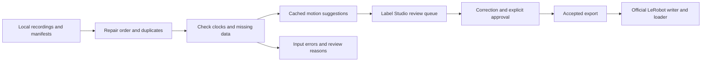

# Robot episode curation

The goal is autonomous robot-episode labeling with minimal human correction. The next milestone is to compare the pipeline's unedited semantic predictions directly with independently labeled, held-out ground truth. Broader messy-data recovery comes after that labeling benchmark.

The current implementation prepares recordings for review and exports accepted annotations to LeRobot. It checks video and robot streams, repairs sample order and exact duplicates, proposes coarse motion segments, and sends uncertain or incomplete episodes to Label Studio. An explicit approval controls which annotations enter an export. A learned semantic labeler and a held-out evaluation of its predictions are still missing.


This screenshot comes from an automated integration test using DROID footage by Khazatsky et al. (2024), under [CC-BY-4.0](https://creativecommons.org/licenses/by/4.0/). The displayed variant has missing numeric samples and an inferred 15 Hz clock. It is not a human-reviewed training example.

## Run the workflow

Install Python 3.12, uv 0.12.23 and FFmpeg with FFprobe, then run:

```bash
./scripts/setup.sh
uv run --locked python -m robo preflight
```

Follow the [real DROID demo](docs/demo.md) to download a pinned 9.54 MB shard, open a review queue, check an accepted export with the official LeRobot loader, and run the corruption benchmark. To use your own recordings, create local manifests using the [episode contract](docs/data-contract.md):

```bash
uv run --locked python -m robo --store data/local/work batch run PATH_TO_INBOX
uv run --locked python -m robo --store data/local/work batch status
uv run --locked python -m robo --store data/local/work serve
```

Open `http://127.0.0.1:8000` and use Label Studio's local setup or login. In another terminal, with an existing authorized `LABEL_STUDIO_API_KEY`, run:

```bash
uv run --locked python -m robo --store data/local/work batch sync
```

Open the **Review priority** tab and click a task row. Correct the annotation, submit it, and follow the [approval commands](docs/native-approval.md) to accept that saved revision. Then export:

```bash
uv run --locked python -m robo --store data/local/work batch export artifacts/accepted --split train
```

The [batch guide](docs/batch-workflow.md) explains retries, failed inputs and queue counts. Reruns reuse completed work and check source hashes. Changed native annotations require a new approval before another export.

## What runs automatically



The importer keeps original video and numeric values. Review uses a separate constant-rate video with a frame map back to the source. Training conversion checks an explicit state/action schema and uses causal samples within declared tolerances. Missing values are not filled in.

Automation prepares and prioritizes work. Motion suggestions and uncertainty scores are heuristic; semantic labels still require review.

## Evaluate autonomous labels

The comparison must score predictions before a person corrects them. Use independent reference labels with a fixed taxonomy and boundary rules, and keep related sessions and near-duplicate episodes in the same split. Hold test labels out of training, prompt changes and threshold selection.

Report per-class precision, recall and temporal segment F1, boundary error, missed labels and the amount of human review requested. Show corrected results separately so they do not inflate autonomous accuracy. The existing [evaluator](docs/results.md#evaluate-supplied-review-artifacts) has fixture tests for matching and metrics, but no held-out semantic-labeling result has been measured. DROID's language instructions and the automated review fixtures are not ground-truth temporal annotations.

## Future work informed by Physical Intelligence

PI's [π₀.₅ research](https://www.pi.website/blog/pi05) uses semantic subtask instructions, high-level prediction of the next subtask, and co-training across robot actions and multimodal data. The public [openpi release](https://github.com/Physical-Intelligence/openpi/blob/215abfb217dbac7d5f1273282331b9b1866c0479/README.md) supports the π₀.₅ flow-matching head for training and inference; reproducing the full research recipe would require additional work. These sources suggest three future priorities for this project:

1. **Text-labeled temporal segments are core to the planned prototype.** Propose observable subtask descriptions and start/end boundaries, with uncertain cases sent to review. [π₀.₇ §V-A](https://www.pi.website/download/pi07.pdf#page=4) annotates segments with detailed text; [Appendix C](https://www.pi.website/download/pi07.pdf#page=22) links temporal-label quality to visual-subgoal quality. Evaluate both text and boundaries.
2. **Validated quality and mistake metadata next.** [π₀.₇ §V-C–E](https://www.pi.website/download/pi07.pdf#page=5) uses episode length in timesteps as speed metadata, human annotations of quality (1–5) and mistake segments, and `joint`/`ee` control labels. We could test comparable annotations against a human rubric before using them for training. Control labels must describe the actual action representation; adding a label does not convert joint actions into end-effector actions.
3. **Visual subgoals as later research.** [π₀.₇ §V-B](https://www.pi.website/download/pi07.pdf#page=5) uses segment-end frames as training targets and a BAGEL-initialized world model to generate subgoals at inference. Exploring this would require a separate model and evaluation; it is not a requirement for the standard [π₀.₅ DROID configuration](https://github.com/Physical-Intelligence/openpi/blob/215abfb217dbac7d5f1273282331b9b1866c0479/src/openpi/training/config.py).

Following [π₀.₇'s documented inputs and memory architecture (§IV–VI)](https://www.pi.website/download/pi07.pdf#page=4), the proposed schema would connect task/subtask text and boundaries with camera views, observation/state history, actions, control mode, episode metadata and optional subgoal-frame references. Representing those inputs would not provide a trained high-level policy, MEM-style history encoder, visual world model or metadata-conditioned action policy. Those components remain separate future work, subject to plan approval and data/compute prerequisites. This project provides no π₀.₇ weights or reproduction.

SAM, Grounding DINO and Qwen are optional tools we might evaluate, not tools attributed to PI's published annotation process. Masks and tracking would be aids to labeling, justified only if they improve the measured result.

The primary benchmark remains uncorrected predictions against independent, held-out ground truth. A separate future policy ablation would compare original versus enriched annotations with the same data splits, training recipe and compute budget, then measure held-out task performance. Better annotation scores alone would not establish better robot control.

## Next phase: broader messy-data recovery

The existing [controlled benchmark](docs/messy-droid.md) is a limited starting point: 16 variants of one real episode, with four repaired, three flagged for data review, seven rejected and two clean controls. It found no silent corruption in those cases. Those results test structural recovery, not semantic-label accuracy. Broader recovery from naturally messy recordings is the next phase after the autonomous-labeling evaluation. Human time savings and performance on arbitrary messy recordings remain unmeasured.

## Training and MLX

The [LeRobot adapter](docs/lerobot.md) writes local v3 datasets and checks them with the official loader and PyTorch DataLoader. The DROID test compares all 119 loaded state/action vectors with the decoded source. Its action schema is seven absolute joint positions and one gripper closure value.

The [MLX adapter](docs/mlx.md) trains the π₀.₅ action expert while keeping the official LeRobot encoder frozen. Small-model CPU tests compare loss, all gradients, an optimizer update and checkpoint resume against the official implementation. Full pretrained execution still needs an authorized tokenizer and local weights. M5 Pro memory, Metal performance and policy quality have not been measured.

## Verify a change

```bash
uv run --locked pytest -q
uv run --locked ruff check .
uv run --locked ruff format --check .
npm ci --cache .cache/npm
npm run check:web
npm run format:check
uv run --locked python -m scripts.labelstudio_smoke --browser
```

Browser verification requires Chromium or Chrome with H.264 support. Set `CHROMIUM_PATH` if it is outside the usual system locations. See [development setup](docs/development.md) for recording dependencies and the isolated training runtimes.

[Results](docs/results.md) · [Architecture](docs/architecture.md) · [Dataset card](docs/dataset-card.md) · [Model sources](docs/models.md)

This project uses Label Studio's maintained application and official SDK. The earlier editor remains behind `--legacy-editor` for regression tests. The project is independent of Physical Intelligence.
