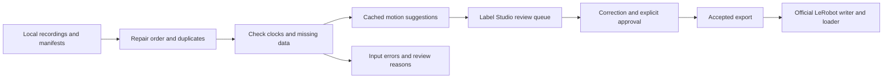

# Robot episode curation

Turn local robot recordings into reviewed datasets for LeRobot. The pipeline checks video and robot streams, repairs sample order and exact duplicates, proposes motion segments, and sends uncertain or incomplete episodes to Label Studio. An explicit approval controls which annotations enter an export.


This screenshot comes from an automated integration test using DROID footage by Khazatsky et al. (2024), under [CC-BY-4.0](https://creativecommons.org/licenses/by/4.0/). The displayed variant has missing numeric samples and an inferred 15 Hz clock. It is not a human-reviewed training example.

## Run the workflow

Install Python 3.12, uv 0.12.23 and FFmpeg with FFprobe, then run:

```bash
./scripts/setup.sh
uv run --locked python -m robo preflight
```

Follow the [real DROID demo](docs/demo.md) to download a pinned 9.54 MB shard, open a review queue, check an accepted export with the official LeRobot loader, and run the corruption benchmark. To use your own recordings, create local manifests using the [episode contract](docs/data-contract.md):

```bash
uv run --locked python -m robo --store data/local/work batch run PATH_TO_INBOX
uv run --locked python -m robo --store data/local/work batch status
uv run --locked python -m robo --store data/local/work serve
```

Open `http://127.0.0.1:8000` and use Label Studio's local setup or login. In another terminal, with an existing authorized `LABEL_STUDIO_API_KEY`, run:

```bash
uv run --locked python -m robo --store data/local/work batch sync
```

Open the **Review priority** tab and click a task row. Correct the annotation, submit it, and follow the [approval commands](docs/native-approval.md) to accept that saved revision. Then export:

```bash
uv run --locked python -m robo --store data/local/work batch export artifacts/accepted --split train
```

The [batch guide](docs/batch-workflow.md) explains retries, failed inputs and queue counts. Reruns reuse completed work and check source hashes. Changed native annotations require a new approval before another export.

## What runs automatically



The importer keeps original video and numeric values. Review uses a separate constant-rate video with a frame map back to the source. Training conversion checks an explicit state/action schema and uses causal samples within declared tolerances. Missing values are not filled in.

Automation prepares and prioritizes work. Motion suggestions are coarse, uncertainty scores are heuristic, and semantic labels still require review. The [controlled benchmark](docs/messy-droid.md) covers 16 variants of one real episode: four repaired, three flagged for data review, seven rejected and two clean controls. It found no silent corruption in those cases. Human time savings and performance on arbitrary messy recordings remain unmeasured.

## Training and MLX

The [LeRobot adapter](docs/lerobot.md) writes local v3 datasets and checks them with the official loader and PyTorch DataLoader. The DROID test compares all 119 loaded state/action vectors with the decoded source. Its action schema is seven absolute joint positions and one gripper closure value.

The [MLX adapter](docs/mlx.md) trains the π₀.₅ action expert while keeping the official LeRobot encoder frozen. On the Mac, all 14 model tests use MLX Metal with the official encoder and reference on MPS. CPU fallback is disabled. The tests compare loss, all gradients, an optimizer update and checkpoint resume. Full pretrained preprocessing still needs an authorized tokenizer and local weights. Memory use, sustained Metal performance and policy quality have not been measured.

## Verify a change

```bash
uv run --locked pytest -q
uv run --locked ruff check .
uv run --locked ruff format --check .
npm ci --cache .cache/npm
npm run check:web
npm run format:check
uv run --locked python -m scripts.labelstudio_smoke --browser
```

Browser verification requires Chromium or Chrome with H.264 support. Set `CHROMIUM_PATH` if it is outside the usual system locations. See [development setup](docs/development.md) for recording dependencies and the isolated training runtimes.

[Results](docs/results.md) · [Architecture](docs/architecture.md) · [Dataset card](docs/dataset-card.md) · [Model sources](docs/models.md)

This project uses Label Studio's maintained application and official SDK. The earlier editor remains behind `--legacy-editor` for regression tests. The project is independent of Physical Intelligence.
