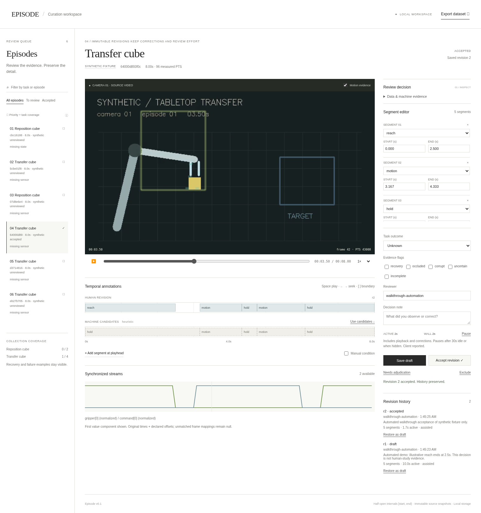
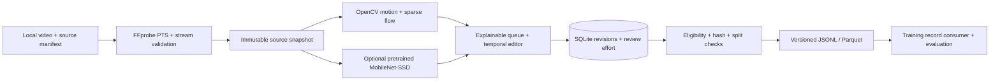

# Episode / Robot data curation

A local workspace for turning robot video and synchronized streams into reviewed, versioned training records. Inspect machine evidence, correct temporal annotations, keep an audit trail, and export only accepted revisions.



[Watch the browser walkthrough](docs/evidence/review-walkthrough.webm) · [Export view](docs/evidence/dataset-export.png) · [Evidence and limitations](docs/results.md)

## Run it

Requires Python 3.12, uv 0.12.23, FFmpeg/FFprobe. No account, GPU or paid service is needed. The editor uses a restrained, light layout with the video and timeline as its main surfaces.

```bash
./scripts/setup.sh
uv run --locked python -m robo demo
uv run --locked python -m robo serve
# Open http://127.0.0.1:8000
```

This creates **six synthetic, eight-second illustrated episodes**, with generated state/action streams, one video-only case, and a blurred interval. They validate software mechanics. They are not physical robot demonstrations or human annotation research.

1. Select an episode; inspect video, original presentation timestamps and available streams.
2. Start manually or use heuristic motion candidates. Edit labels and boundaries; use `Space`, arrows, `[` and `]` for playback and boundaries.
3. Save a draft with a reviewer ID and decision note. Accept it in a separate action. Uncertain evidence can go to adjudication; exclusion needs a note.
4. Export accepted revisions to JSONL and Parquet. Choose splits by session; validation rejects leakage and changed source files.

An edit to an accepted revision creates a new draft. A second browser tab cannot overwrite a newer revision. Restore creates a draft while retaining all prior decisions. Active timing includes playback and correction, counts visible playback throughout, pauses after 30 seconds of editing idle time or when hidden, and is explicitly client reported.

## What runs today



| Capability | Implemented behavior | Limit |
| --- | --- | --- |
| Import | Stable identity, immutable copied video, original PTS/time base, units, offsets, nearest-sample masks | One primary camera; local manifest adapter |
| Perception | Motion regions, sparse optical flow, cached motion/hold segments; optional pretrained VOC object detector | No learned action recognition, masks, or persistent object identities |
| Review | Video seeking, temporal tracks, boundary editing, manual condition, uncertainty, restore, audit and timing | Local trusted reviewers; no authentication |
| Curation | Warning reasons, task diversity, exact duplicate groups, seeded random baseline, before/after coverage | No learned ranking or near-duplicate embeddings |
| Export | Latest accepted revisions, complete audit/provenance, streams/masks, content hashes, session/duplicate split checks | Media references only; no policy-training claim |
| Evaluation | Optimal one-to-one temporal matching, F1 at 0.3/0.5/0.7, boundary errors, agreement, all-event timing, group bootstrap, fixed-budget error recall | Human study and real-data quality results remain unmeasured |

## Pretrained object evidence

```bash
uv run --locked python -m scripts.fetch_model
# Choose an episode ID printed by demo or import:
uv run --locked python -m robo perceive EPISODE_ID --sample-every-s 0.5 --max-frames 600
```

The fetcher pins the source commit, license and SHA256 of every model file. Inference runs offline, decodes one frame at a time, and caps sampled frames. The model is lazy loaded by the CLI, outside HTTP requests. Reopen an episode to inspect evidence-linked boxes and scores. We exercised this backend on the illustrated fixtures; its object guesses can be wrong. Scores are uncalibrated and do not establish contact, grasping or task success. See [model provenance](docs/models.md).

## Bring local robot data

```bash
uv run --locked python -m robo --store data/local/pilot import path/to/source.json
uv run --locked python -m robo --store data/local/pilot suggest EPISODE_ID
uv run --locked python -m robo --store data/local/pilot serve
```

[Source schema and example](docs/data-contract.md) · [DROID acquisition record](docs/dataset-card.md). DROID acquisition was blocked by the runtime proxy; **no DROID episodes were acquired**. The documented 100-episode subset is a next pilot, subject to the byte budget, provenance and timing checks. Video-only sources remain useful and do not acquire invented robot states.

```bash
uv run --locked python -m robo curate --count 4 --policy prioritized --output artifacts/selection.json
uv run --locked python -m robo curate --count 4 --policy random --seed 7 --output artifacts/random.json
uv run --locked python -m robo export examples/export-selection.json artifacts/dataset-v1
uv run --locked python -m robo validate-export artifacts/dataset-v1
uv run --locked python -m robo evaluate examples/synthetic-evaluation.json artifacts/evaluation.json
```

Edit the export example with your accepted episode/revision IDs. A curation selection schedules review; it does not approve training annotations. `validate-export` exercises the actual JSONL/Parquet consumer. It does not train a policy.

## Verify

```bash
uv run --locked python scripts/check_environment.py
uv run --locked pytest -q
uv run --locked ruff check .
uv run --locked ruff format --check .
npm ci --cache .cache/npm
npm run check:web
npm run format:check
PLAYWRIGHT_BROWSERS_PATH=.cache/playwright npx playwright install --with-deps chromium ffmpeg
npm run test:e2e
```

Browser tests use a disposable collection and record video. On the saved cloud environment, system Chromium/FFmpeg are available; [development notes](docs/development.md) describe reusing them. Optional model tests skip when weights are absent; fetch the pinned model to run them. CI fetches the model and exercises the same smoke test.

## Why this design

One Python process and SQLite are sufficient for a small pilot. File snapshots separate immutable processing from transactional human decisions. The browser uses native JavaScript and CSS, served directly by FastAPI: no frontend build service or client framework is needed for this single editor. This deliberately departs from the proposed React/TypeScript stack; browser behavior tests and formatting checks cover the shipped interactions, while static TypeScript guarantees are absent.

The first learned detector is small enough to exercise in the CPU executor and download reproducibly. It provides object evidence alongside a transparent temporal baseline, leaving human semantic decisions visible. [Architecture and tradeoffs](docs/architecture.md) explain the boundaries; [hardware choice](docs/models.md#hardware-choice) recommends the RTX 3060 workstation for a future CUDA perception extension without claiming that this CPU backend uses its VRAM.

The research question remains **accepted, correct annotations per human hour**. No time savings, throughput improvement, inter-reviewer result, real robot quality benchmark or improved policy performance is claimed. This is independent work and does not describe Physical Intelligence's internal systems.
