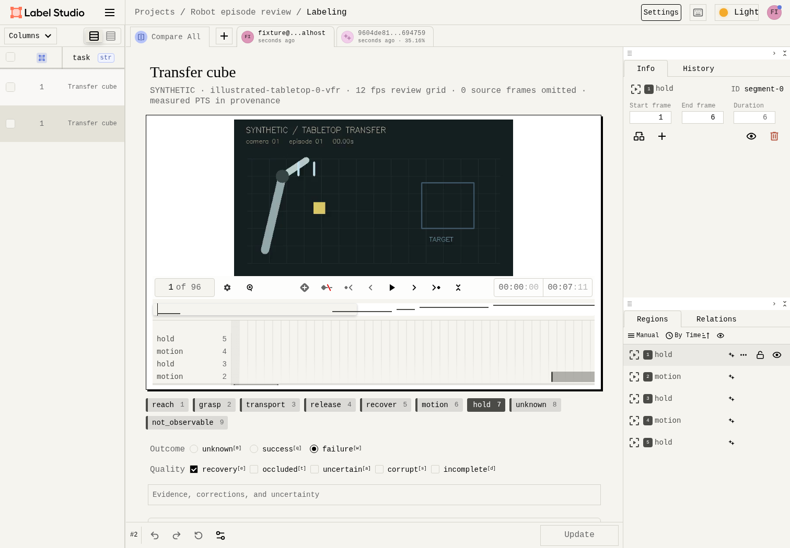
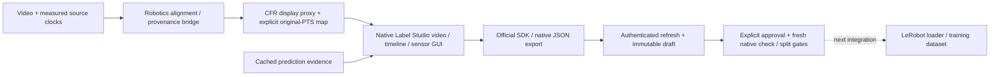

# Robot episode curation

A local robotics data pipeline built around **Label Studio**, with project code focused on source alignment, provenance, assisted-review integration and evaluation.



The real Label Studio application and official SDK import video/sensor tasks and predictions, save corrections, and connect them to explicit approval and immutable accepted exports. New approvals/exports check the selected native revision and machine provenance. The earlier bespoke editor is a development prototype, available only through `--legacy-editor`; native-bound episodes cannot bypass the approval bridge through it.

## Run the native GUI

Requires Python 3.12, uv 0.12.23, FFmpeg/FFprobe. The lockfile includes Label Studio 1.23.2 and SDK 2.1.2.

```bash
./scripts/setup.sh
uv run --locked python -m robo demo
# Choose an episode ID printed above:
uv run --locked python -m robo prepare-labelstudio EPISODE_ID
uv run --locked python -m robo serve
# Open http://127.0.0.1:8000
```

`serve` starts native Label Studio on loopback using its normal local authentication. The installer does not provision an account or persistent API credential. Use the application's local setup/login workflow.

For this first slice, create a Label Studio project, paste `artifacts/labelstudio-bundle/review.xml` into its labeling configuration, and import `tasks.json`. Add Local Files source storage at the `local_storage_path` printed by the preparation command, with **Treat every object as a source file** enabled. Do not sync the proxy directory as new tasks; the supplied tasks already bind video and sensor files. [Integration guide](docs/labelstudio.md) explains SDK automation, frame precision and verification; [design notes](docs/design.md) document the PI-inspired styling and retained Label Studio branding.

The demonstration contains six generated illustrated episodes, eight seconds each. Its state/action streams are generated fixtures. It validates software mechanics and does **not** satisfy the real-DROID acceptance gate or establish human annotation savings.

After native Submit/Update, use the [approval workflow](docs/native-approval.md) to bind the task, refresh the chosen annotation into a draft, inspect it and explicitly accept or reject that revision. This thin CLI/SDK gate keeps dataset eligibility separate from saving an annotation. It uses existing authorized access and creates no credentials. The guide includes copyable commands and the precise freshness limitations.

## Ownership



| Boundary | Current state |
| --- | --- |
| Source ingest | Immutable video snapshots, measured PTS, optional streams, declared units/offsets and missing-data masks |
| Mature review UI | Native Video, TimelineLabels and synchronized TimeSeries; project theme uses supported Style/View configuration |
| SDK bridge | Actual project/task/prediction import, correction, native JSON export and trusted task/source/proxy validation exercised |
| Timing/approval | Explicit accept/reject with revision freshness, pinned native provenance and checked new exports. Native `lead_time` is retained; active human time stays null and is excluded from efficiency estimates |
| Curation/evaluation | Transparent ranking, coverage and evaluation machinery from the prototype remain reusable; integration with Label Studio task scheduling is pending |
| Training format | Existing project JSONL/Parquet consumer is tested; actual LeRobot round-trip is an open integration gate |
| Real data | DROID acquisition blocked by the prior runtime proxy; no DROID bytes acquired |
| MLX / PI family | Authorized next phase targets π₀.₅ compatibility/training on M5 Pro; not implemented or measured |

The constant-rate review proxy is deliberately separate from raw observations. Its manifest maps every display frame to the original source frame, integer PTS and source time. Sensor plots use a zero-anchored display grid with nearest samples and blank gaps, while original streams remain intact. Temporal exports use explicit review-grid intervals and include the measured source frames bracketing each boundary. The default proxy retains all source frames up to 60 fps; an explicit coarser rate reports omitted frames. The grid is not a lossless representation of arbitrary source timestamps. [Data contract](docs/data-contract.md) · [Dataset card](docs/dataset-card.md).

## Verify

```bash
uv run --locked pytest -q
uv run --locked ruff check .
uv run --locked ruff format --check .
npm ci --cache .cache/npm
npm run check:web
npm run format:check
# Uses a disposable database/session; no persistent API credential:
uv run --locked python -m scripts.labelstudio_smoke --browser
```

The native smoke test uses installed system Chromium by default. Set `CHROMIUM_PATH` for another installation; CI uses Chrome for H.264. It disables telemetry and blocks non-local browser requests. Legacy browser regression tests remain under `npm run test:e2e`; see [development notes](docs/development.md) for the locked Playwright recording prerequisite.

[Verification and limits](docs/results.md) · [Original study protocol](docs/evaluation.md) · [Model provenance](docs/models.md). No human time reduction, real-data quality improvement, policy performance or Apple training result is claimed. This project is independent of Physical Intelligence.
