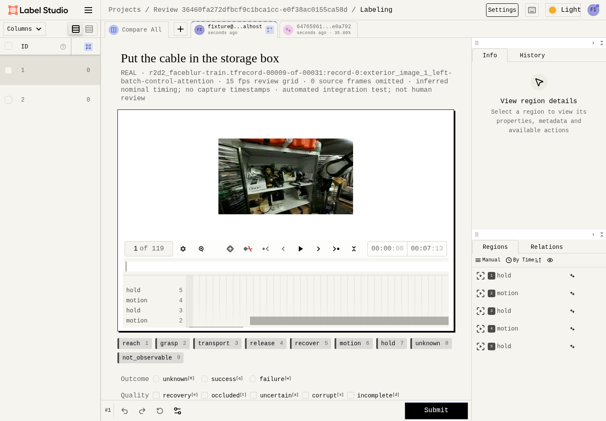
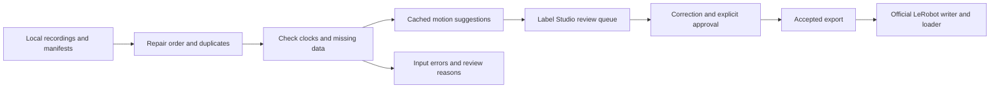

# Robot episode curation

The goal is autonomous robot-episode labeling with minimal human correction. The next milestone is to compare the pipeline's unedited semantic predictions directly with independently labeled, held-out ground truth. Broader messy-data recovery comes after that labeling benchmark.

The current implementation prepares recordings for review and exports accepted annotations to LeRobot. It checks video and robot streams, repairs sample order and exact duplicates, proposes coarse motion segments, and sends uncertain or incomplete episodes to Label Studio. An explicit approval controls which annotations enter an export. A learned semantic labeler and a held-out evaluation of its predictions are still missing.



This screenshot comes from an automated integration test using DROID footage by Khazatsky et al. (2024), under [CC-BY-4.0](https://creativecommons.org/licenses/by/4.0/). The displayed variant has missing numeric samples and an inferred 15 Hz clock. It is not a human-reviewed training example.

## Run the workflow

Install Python 3.12, uv 0.12.23 and FFmpeg with FFprobe, then run:

```bash
./scripts/setup.sh
uv run --locked python -m robo preflight
```

Follow the [real DROID demo](docs/demo.md) to download a pinned 9.54 MB shard, open a review queue, check an accepted export with the official LeRobot loader, and run the corruption benchmark. To use your own recordings, create local manifests using the [episode contract](docs/data-contract.md):

```bash
uv run --locked python -m robo --store data/local/work batch run PATH_TO_INBOX
uv run --locked python -m robo --store data/local/work batch status
uv run --locked python -m robo --store data/local/work serve
```

Open `http://127.0.0.1:8000` and use Label Studio's local setup or login. In another terminal, with an existing authorized `LABEL_STUDIO_API_KEY`, run:

```bash
uv run --locked python -m robo --store data/local/work batch sync
```

Open the **Review priority** tab and click a task row. Correct the annotation, submit it, and follow the [approval commands](docs/native-approval.md) to accept that saved revision. Then export:

```bash
uv run --locked python -m robo --store data/local/work batch export artifacts/accepted --split train
```

The [batch guide](docs/batch-workflow.md) explains retries, failed inputs and queue counts. Reruns reuse completed work and check source hashes. Changed native annotations require a new approval before another export.

Already have DROID TFRecord shards? The [local RLDS intake](docs/droid-local-intake.md) converts a bounded set of episodes into this batch inbox, records provenance and resumes interrupted work. It also reports incomplete shard sets. The pinned pilot remains available for a small reproducible check.

## What runs automatically



The importer keeps original video and numeric values. Review uses a separate constant-rate video with a frame map back to the source. Training conversion checks an explicit state/action schema and uses causal samples within declared tolerances. Missing values are not filled in.

Automation prepares and prioritizes work. Motion suggestions and uncertainty scores are heuristic; semantic labels still require review.

## Evaluate autonomous labels

The comparison must score predictions before a person corrects them. Use independent reference labels with a fixed taxonomy and boundary rules, and keep related sessions and near-duplicate episodes in the same split. Hold test labels out of training, prompt changes and threshold selection.

Report per-class precision, recall and temporal segment F1, boundary error, missed labels and the amount of human review requested. Show corrected results separately so they do not inflate autonomous accuracy. The existing [evaluator](docs/results.md#evaluate-supplied-review-artifacts) has fixture tests for matching and metrics, but no held-out semantic-labeling result has been measured. DROID's language instructions and the automated review fixtures are not ground-truth temporal annotations.

The [semantic contract and evaluator](docs/semantic-evaluation.md) accept text-labeled segments with source-frame evidence, a frozen split manifest, and separate prediction/reference files. They score normalized actions and exact object labels, retain failed episodes in the denominator, and check reference and split declarations. Generated tests cover the contract; real semantic accuracy still requires independent annotations and model predictions.

The [robot-state baseline](docs/semantic-state-baseline.md) produces coarse text-labeled motion and gripper candidates in that format. It has run on the 119-frame DROID pilot, but its object/contact interpretation and accuracy remain unverified. The [local Qwen adapter](docs/qwen-semantic-adapter.md) adds bounded sampled-image inference and strict output validation. Its official tiny-model execution tests pass; full pretrained labeling still needs the pinned local weights and independent references.

## Future work: a small semantic-labeling prototype

PI's [π₀.₅ research](https://www.pi.website/blog/pi05) uses semantic subtask instructions and high-level subtask prediction alongside multimodal co-training. [π₀.₇ §V-A](https://www.pi.website/download/pi07.pdf#page=4) also annotates temporal segments with detailed subtask text. That motivates making **text-labeled temporal segments** the core output of our planned prototype.

Keep the scope small: **DROID → automatic text-labeled segments → independent ground-truth comparison → review/export**. Start with a small video-language model that proposes subtask text and start/end boundaries, and compare it with a robot-state baseline on the same held-out episodes. Score uncorrected predictions against independent reference annotations before sending uncertain cases to review. Use the existing approval and export workflow.

Object tracking would be added only if it measurably improves annotation quality or reduces review workload. World models, memory-heavy controllers and a full π₀.₇ reproduction are outside this prototype. These are proposed experiments; implementation still requires plan approval and suitable model/data access.

The direct annotation benchmark remains primary. An original-versus-enriched policy ablation would be a separate later experiment, with matched data splits, training recipe and compute budget. It would test whether better annotations improve held-out robot-task performance; the annotation benchmark alone cannot establish that.

## Next phase: broader messy-data recovery

The existing [controlled benchmark](docs/messy-droid.md) is a limited starting point: 16 variants of one real episode, with four repaired, three flagged for data review, seven rejected and two clean controls. It found no silent corruption in those cases. Those results test structural recovery, not semantic-label accuracy. Broader recovery from naturally messy recordings is the next phase after the autonomous-labeling evaluation. Human time savings and performance on arbitrary messy recordings remain unmeasured.

## Training and MLX

The [LeRobot adapter](docs/lerobot.md) writes local v3 datasets and checks them with the official loader and PyTorch DataLoader. The DROID test compares all 119 loaded state/action vectors with the decoded source. Its action schema is seven absolute joint positions and one gripper closure value.

The [MLX adapter](docs/mlx.md) trains the π₀.₅ action expert while keeping the official LeRobot encoder frozen. On the Mac, all 14 model tests use MLX Metal with the official encoder and reference on MPS. CPU fallback is disabled. A [full pretrained inference run](docs/evidence/pi05-synthetic-metal.json) also passes from generated camera images, state and task text through the official preprocessing and postprocessing. Its 50-step, 32-dimension action chunk matches the full MPS reference within `6.11e-7`. This uses synthetic statistics and no real dataset. Memory use, sustained Metal performance and policy quality have not been measured.

## Verify a change

```bash
uv run --locked pytest -q
uv run --locked ruff check .
uv run --locked ruff format --check .
npm ci --cache .cache/npm
npm run check:web
npm run format:check
uv run --locked python -m scripts.labelstudio_smoke --browser
```

Browser verification requires Chromium or Chrome with H.264 support. Set `CHROMIUM_PATH` if it is outside the usual system locations. See [development setup](docs/development.md) for recording dependencies and the isolated training runtimes.

[Results](docs/results.md) · [Architecture](docs/architecture.md) · [Dataset card](docs/dataset-card.md) · [Model sources](docs/models.md)

This project uses Label Studio's maintained application and official SDK. The earlier editor remains behind `--legacy-editor` for regression tests. The project is independent of Physical Intelligence.
