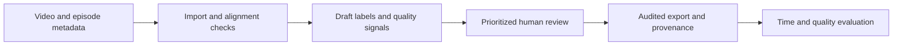

# Robot Episode Curation & Assisted Annotation

A planned human review pipeline that turns robot demonstration videos and synchronized metadata into audited, versioned training examples.

The research question is whether automated draft labels and targeted review can reduce human annotation time while preserving label quality. The intended portfolio artifact is a reproducible experiment and a working review workflow that a robotics data team can inspect.

## Current status

This repository contains the project plan and a reproducible CPU development environment. The episode pipeline, review UI, model integrations, and experiment results are not implemented yet. No performance improvement is claimed.

## Read the plan

- [Build roadmap](docs/plan.md): scope, milestones, acceptance gates, and the first implementation task.
- [Architecture](docs/architecture.md): data contracts, ownership, interfaces, and design alternatives.
- [Evaluation protocol](docs/evaluation.md): reference labels, timing, baselines, and publication criteria.
- [Development environment](docs/development.md): installation, verification, and cloud lifecycle.
- [Decision and verification record](docs/decisions.md): what was selected and what has actually been checked.

## Set up development

Prerequisites: Python 3.12, uv 0.12.23, FFmpeg and FFprobe with H.264 support.

```bash
./scripts/setup.sh
uv run --locked python scripts/check_environment.py
uv run --locked ruff check .
uv run --locked ruff format --check .
```

The environment check generates a temporary video, decodes it, round-trips a Parquet table, and makes a request to a temporary FastAPI test application. It validates dependencies, not the future robotics pipeline. It needs no dataset, model weights, GPU, or API keys.

Python dependencies are locked in `uv.lock`. Large datasets, checkpoints, generated artifacts, and credentials must remain outside Git. The planned React review UI and optional model runtimes will receive their own pinned dependencies when implemented.

## Intended demonstration



A reviewer should be able to inspect a robot episode, correct a temporal label, see the audit history, and export a reproducible dataset version. The final report will compare manual review, assisted review, and review prioritization at a fixed annotation budget.

This is an independent portfolio project. It is not affiliated with Physical Intelligence and does not describe its internal systems.
