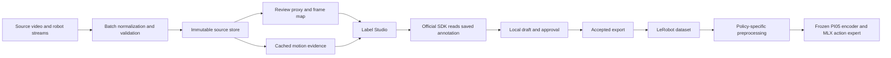

# Architecture

Label Studio 1.23.2 owns the annotation UI, authentication and saved annotations. The Python bridge checks robot data, prepares suggestions and decides which saved revisions are eligible for export. LeRobot 0.6.1 writes and loads the training dataset in a separate environment.

| Code | Responsibility |
| --- | --- |
| `robo/recovery.py`, `robo/pipeline.py` | Restore sample order, remove exact duplicates, run resumable stages and report failed or incomplete inputs |
| `robo/ingest.py` | Validate manifests, copy source bytes and preserve original timestamps and streams |
| `robo/analysis.py`, `robo/perception.py` | Cache suggestions with model, configuration and source hashes |
| `robo/labelstudio.py`, `robo/native_queue.py` | Prepare display media, publish tasks and maintain queue reasons |
| `robo/native_review.py` | Read a selected native annotation, create a draft, accept or reject it, and recheck it before export |
| `robo/store.py`, `robo/export.py` | Keep immutable revisions, reject stale writes and prevent session or media leakage across splits |
| `robo/lerobot_plan.py`, `robo/lerobot_export.py` | Check causal alignment and explicit feature mappings, then write a local dataset through LeRobot |
| `integrations/mlx_pi/` | Train the MLX action expert using a frozen official encoder and saved preprocessing |
| `scripts/messy_droid.py`, `robo/evaluation.py` | Evaluate controlled corruptions and, when supplied, human-study artifacts |

The source clock remains the reference. Each review frame maps to an original frame index, integer PTS and episode time. Sensor displays use declared offsets and show blanks where no sample is close enough. Training uses the original streams and a causal sampling rule, not the display CSV. DROID's nominal clock remains marked as inferred throughout.

Saving in Label Studio creates no approval. The bridge imports a specific saved annotation and requires a separate decision. It checks native content again before approval and new exports. These reads cannot form a transaction across Label Studio and SQLite, so users must finish concurrent editing first. Historical exports remain immutable even if a later annotation changes.

The batch report stores progress by input. A failed episode does not stop the others, and a rerun checks source integrity before reusing artifacts. Native task imports recover from a lost response by matching the original payload. The [batch guide](batch-workflow.md) describes that workflow.

All services bind to loopback. Local files and review proxies stay beneath the selected store. The old FastAPI editor is available through `--legacy-editor` for regression tests; native-bound episodes cannot use it to bypass approval. The Label Studio theme uses supported Style and View tags, without a frontend fork.

See the [data contract](data-contract.md), [native approval rules](native-approval.md) and [training format](lerobot.md) for the detailed contracts.
