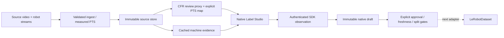

# Architecture

The current product uses self-hosted Label Studio 1.23.2 with official SDK 2.1.2. Project code handles robotics source clocks, immutable provenance, assistance, eligibility and evaluation. LeRobot is the selected next training-facing integration. This supersedes the original custom-editor design.

| Owner | Contract |
| --- | --- |
| `robo/ingest.py` | Validate manifests, snapshot source bytes, preserve measured integer PTS/time base and original optional streams |
| `robo/analysis.py`, `robo/perception.py` | Cache bounded machine runs with exact config/model/source hashes; never mutate human decisions |
| `robo/labelstudio.py` | Create a separate CFR display proxy, map native frame spans to a declared review grid with measured-source brackets, publish through SDK and verify exported task/source/proxy bindings |
| Native Label Studio | Authentication, video/timeline editing, synchronized sensor plots, annotation persistence and native export |
| `robo/native_review.py` | Authenticated native refresh, control decoding, pinned machine origin, explicit approval/rejection and new-export freshness checks |
| `robo/store.py`, `robo/export.py` | Immutable revision/acceptance history, stale-write protection, native-path bypass rejection and grouped split gates |
| `robo/evaluation.py` | Temporal matching, error accounting and optional real reviewer measurements; fixture outputs are labeled synthetic |

The source clock is authoritative. Review proxies hold the last measured frame and record each display frame's original source index, integer PTS and episode time. The generated review grid is explicitly distinct from measured source evidence. Source brackets expose gaps; the default proxy retains all source frames, while explicit coarse rates report omissions. Display sensor CSV uses declared offsets and tolerance-bound nearest samples with blank gaps; original actions/state remain intact.

Native completion produces a draft snapshot. The [approval bridge](native-approval.md) imports that exact annotation and requires a separate explicit decision. A changed native snapshot blocks new exports until refreshed and approved again; historical files remain valid immutable artifacts. Freshness is checked at authenticated SDK observation boundaries, not continuously or in a distributed transaction. Label Studio's `lead_time` is raw metadata; active human time remains unmeasured and is excluded from efficiency calculations.

Use local files and project-scoped proxy storage on loopback for this bounded pilot. Avoid a second UI/database such as FiftyOne until a distinct curation requirement justifies it. The deprecated standalone Label Studio frontend is not embedded. Styling uses supported Style/View configuration; the upstream application shell remains maintained by Label Studio.

The old FastAPI/editor path survives temporarily behind `--legacy-editor` for regression evidence while approval/timing behavior migrates. It is not a second primary product. Remove it when the native path owns its useful behaviors.

See [native integration](labelstudio.md), [data contract](data-contract.md) and [verified outcomes and remaining gates](results.md).
