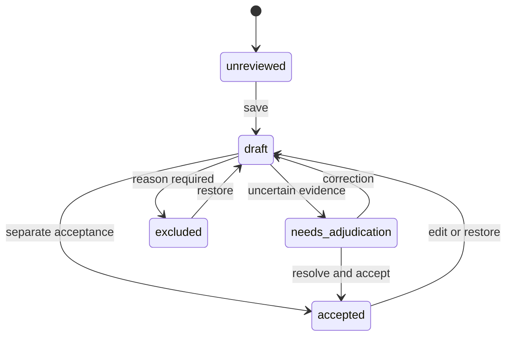

# Episode contract

Copy [the source example](../examples/source.json), point `video` at a local file relative to the manifest, and record verified provenance. Reusing a release/source ID with different content is an error. A path change preserves identity.

A stream is optional. Each supplied stream requires explicit units, strictly increasing finite timestamps, constant-width values, clock evidence, offset and tolerance:

```json
{
  "name": "joint_position",
  "modality": "state",
  "units": "rad",
  "timestamps_s": [0.0, 0.1, 0.23],
  "values": [[0.1, 0.2], [0.12, 0.21], [0.15, 0.22]],
  "offset_s": 0.0,
  "tolerance_s": 0.08,
  "clock_evidence": "Describe how this source clock relates to the video clock"
}
```

Supported modalities: state, action, sensor. Units: rad, rad/s, m, m/s, normalized, N, bool. `normalized` makes no assumption about open/closed gripper semantics. Missing modalities are warnings, never fabricated values. Coverage gaps produce null nearest indices and explicit errors; samples outside episode bounds are rejected. No interpolation is performed.

The pilot accepts H.264 in MP4, at most 512 MiB, 300 seconds, 4K area and 20,000 frames per episode. Explicitly split/transcode larger or incompatible sources and record that transformation; the importer does not silently change source media. Sequential decode bounds frame memory, while PTS, streams and compact evidence remain in memory for the short clip.

Video time authority is the original integer PTS and FFprobe time base. Episode zero is the first video presentation time; original PTS remain in the manifest. Stream mapping is `timestamp_s + offset_s`. A nearest source sample is valid only within the declared tolerance. A large video gap is a warning, not silently repaired.

Human segments are mutually exclusive, ordered half-open intervals `[start_s, end_s)`. Gaps are allowed; overlaps and out-of-bounds endpoints fail. Taxonomy: reach, grasp, transport, release, recover, motion, hold, unknown, not_observable. Use unknown where contact or intent is ambiguous. Recovery is also a separate evidence flag; outcome is success/failure/unknown.



Every action creates an immutable revision with actor, note, previous revision, pinned suggestion and perception origins, condition, active/wall seconds and UTC time. A restore is a new draft. Export pins the latest accepted revision, complete audit trail, source hashes, license, model/config provenance and split membership. It stores nested records as JSON in Parquet to preserve optional heterogeneous stream dimensions; the typed top-level columns are episode ID and split. This is a project schema, not an asserted RLDS/LeRobot adapter.

All media stays in the chosen local store. There is no automatic upload or arbitrary remote URL fetch. Serving is bound to loopback with host/origin checks and byte-range support. This is a trusted local application, without user authentication. Do not expose it as a shared public service.

Review provenance follows the labels actually loaded or restored. A manual revision has no machine origins. An assisted revision keeps its original run IDs until the reviewer explicitly loads different evidence; changing an active offline run does not alter a prior accepted decision or its export.
