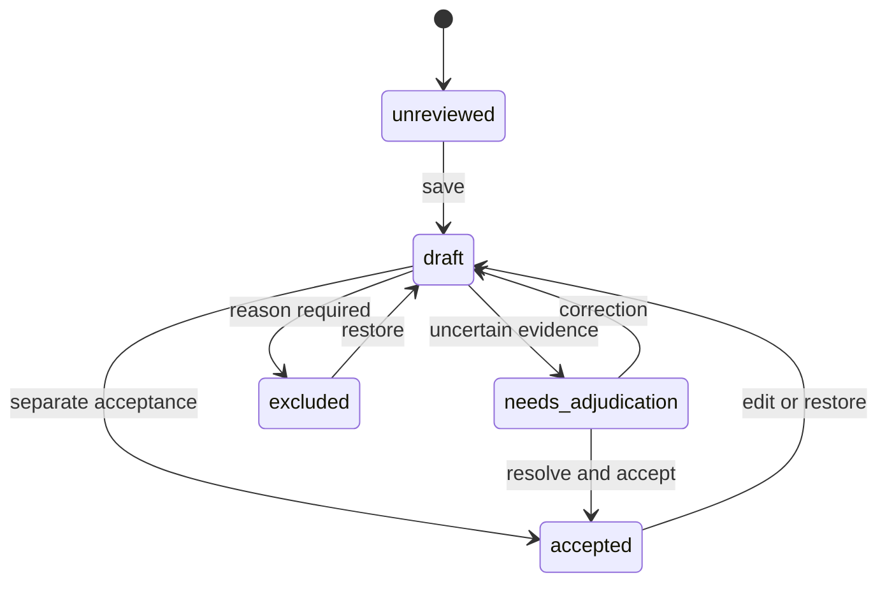

# Episode contract

Copy [the source example](../examples/source.json), point `video` at a local file relative to the manifest, and record verified provenance. Reusing a release/source ID with different content is an error. A path change preserves identity.

Streams are optional. Each supplied stream declares its units, finite timestamps, constant-width values, clock evidence, offset and tolerance. Direct import requires increasing timestamps. Batch intake first sorts paired rows and removes exact duplicates; conflicting duplicates or missing clock metadata require corrected input.

```json
{
  "name": "joint_position",
  "modality": "state",
  "units": "rad",
  "timestamps_s": [0.0, 0.1, 0.23],
  "values": [[0.1, 0.2], [0.12, 0.21], [0.15, 0.22]],
  "offset_s": 0.0,
  "tolerance_s": 0.08,
  "clock_evidence": "Describe how this source clock relates to the video clock"
}
```

The supported stream types are state, action and sensor. Accepted units are rad, rad/s, m, m/s, normalized, N and bool. `normalized` makes no assumption about open/closed gripper semantics. Missing modalities are warnings, never fabricated values. Coverage gaps produce null nearest indices and explicit errors; samples outside episode bounds are rejected. No interpolation is performed.

The pilot accepts H.264 in MP4, at most 512 MiB, 300 seconds, 4K area and 20,000 frames per episode. Explicitly split/transcode larger or incompatible sources and record that transformation; the importer does not silently change source media. Sequential decode bounds frame memory, while PTS, streams and compact evidence remain in memory for the short clip.

Video time authority is the original integer PTS and FFprobe time base. Episode zero is the first video presentation time; original PTS remain in the manifest. Stream mapping is `timestamp_s + offset_s`. A nearest source sample is valid only within the declared tolerance. A large video gap is a warning, not silently repaired.

For frames without original capture times, declare `video_timing: "inferred_nominal_fps"` and explain the nominal rate in provenance and every stream's clock evidence. The [DROID adapter](droid.md) uses this mode. Its generated video PTS are not measured capture times; the review banner, boundary evidence and training alignment retain that distinction. `is_source_frame_boundary` denotes coincidence with a source frame, while `is_measured_source_boundary` stays false for inferred timing. Existing video sources default to `source_pts` without changing their source identity.

Reviewed segments are ordered, nonoverlapping half-open intervals `[start_s, end_s)`. Gaps are allowed; overlaps and out-of-bounds endpoints fail. Taxonomy: reach, grasp, transport, release, recover, motion, hold, unknown, not_observable. Use unknown where contact or intent is ambiguous. Recovery is also a separate evidence flag; outcome is success/failure/unknown.



Every action creates an immutable revision with actor, note, previous revision, pinned suggestion and perception origins, condition, active/wall seconds and UTC time. A restore is a new draft. Export pins the latest accepted revision, complete audit trail, source hashes, license, model/config provenance and split membership. It stores nested records as JSON in Parquet to preserve optional heterogeneous stream dimensions; the typed top-level columns are episode ID and split. This project schema feeds the separate [official LeRobot adapter](lerobot.md).

Media stays in the selected local store. Acquisition is a separate command; import does not fetch arbitrary URLs. Label Studio uses its own authentication and binds to loopback. The earlier editor also binds to loopback but has no user authentication. Neither configuration is intended for public hosting.

Review provenance follows the labels actually loaded or restored. A manual revision has no machine origins. An assisted revision keeps its original run IDs until the reviewer explicitly loads different evidence; changing an active offline run does not alter a prior accepted decision or its export.
