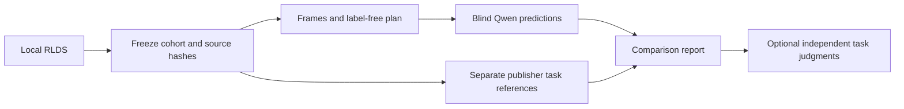

# Compare blind predictions with DROID task descriptions

This benchmark asks what Qwen describes when it cannot read the episode's task
instruction. It then puts those unedited predictions beside DROID's original
task descriptions. DROID provides up to three wordings of an episode's task;
they are not temporal subtask labels or proof that the robot succeeded.

The existing annotation command still supplies task context by default
(`provided-v1`). The benchmark requires `hidden-v1`, which removes task text at
the model prompt boundary. That policy enters the generation configuration,
run identity and prediction receipts. Assisted or older results without this
explicit policy cannot be reused. Original stores and sidecars retain their
labels for integrity checks, so this is input separation, not OS-level isolation.



## Run on a Mac

Use this checkout with Python 3.12, uv 0.12.23 and FFmpeg/FFprobe installed.
Reuse your pinned Qwen assets. These setup commands install locked dependencies;
the benchmark itself downloads neither data nor weights.

```bash
uv sync --locked
uv sync --locked --project integrations/droid
uv sync --locked --project integrations/semantic
```

Create `artifacts/task-benchmark-config.json`. Replace the source path with your
local TFDS directory containing `dataset_info.json`, `features.json` and its
declared TFRecord shards. The earlier one-episode pilot alone is unsuitable:
its entire session is automatically excluded because it was used for debugging.

```json
{
  "source": "~/Downloads/auto-robo-pipeline/data/local/droid_100/1.0.0",
  "model_dir": "~/Downloads/auto-robo-pipeline/models/local/Qwen3-VL-2B-Instruct/89644892e4d85e24eaac8bacfd4f463576704203",
  "release": "droid_100/1.0.0",
  "device": "mps",
  "max_episodes": 3,
  "allow_partial": false,
  "excluded_episode_ids": [],
  "excluded_session_ids": [],
  "exclusions_declared_by": "your name",
  "exclusions_note": "List any additional episodes or sessions used for debugging before prediction."
}
```

Declare all additional debugged episodes or sessions before running. Episode IDs
must be imported IDs or source IDs from existing manifests; session IDs come from
source metadata. An excluded episode excludes its entire session. The frozen
plan retains these records in `development` and selects the remainder as `test`.
Those names express the declared split, not an independently audited holdout.
Do not choose or remove episodes after looking at predictions.

```bash
uv run --locked python -m robo.task_benchmark prepare artifacts/task-benchmark \
  --config artifacts/task-benchmark-config.json
uv run --locked python -m robo.task_benchmark predict artifacts/task-benchmark
uv run --locked python -m robo.task_benchmark report artifacts/task-benchmark
```

`prepare` reads the first bounded records in TFDS shard/record order, checks their
sidecars against conversion receipts and original shard hashes, and freezes the
cohort before inference. The default candidate limit is three, the maximum five;
excluded records still occupy that limit. Existing intake byte and step bounds
apply. Set `allow_partial` explicitly for a partial local download; the manifest
records the missing inventory. An invalid intake blocks cohort creation rather
than silently dropping a record. A cohort with no eligible episodes exits 3.

`predict` runs the existing isolated Qwen runtime once per selected episode, with
MPS CPU fallback disabled and local assets only. Reference file paths and text
are not passed to the prediction subprocess. It freezes raw replies, unedited
predictions and execution receipts. A failed episode stays in the denominator
and makes the command exit 2. It never substitutes a baseline or publishes
approvals or training exports.

Repeat the same commands to check and reuse the frozen run. Changed sources,
configuration, references, provider implementation or predictions are rejected.
Completed episodes are not regenerated. A process interrupted before its receipt
is written remains a failed attempt; use a new, predeclared run to retry and keep
the failed run in your results. New runs must not be selected for reporting based
on their outcomes.

## Read the result

The report command prints the path to an immutable JSON report under
`scoring/reports/`. Run it even if prediction returned 2. It includes:

- Every selected episode, its original predictions and all available publisher
  wordings, with shard, record index, session, camera and source hashes.
- NFKC/casefold word exact match, word-multiset F1 and word-set Jaccard for each
  wording. These are lexical diagnostics, not semantic accuracy. They compare
  concatenated predicted subtask descriptions with an episode instruction, so
  differences in detail and paraphrasing matter.
- Failure, unjudged and review-routing counts. Routing uses the existing gap,
  unknown-action and uncertainty rules; confidence is not calibrated correctness,
  and routing counts do not measure human labor.
- Model configuration and execution receipts. Per-episode elapsed time includes
  model loading, decoding and generation. Peak RSS and Metal memory are not measured.

`scoring/references.json` is a task-reference artifact, not a `References` file for
the temporal evaluator. Boundary metrics remain unavailable. The existing
temporal evaluator still requires separate suitable references and identity and
independence audits; this command does not weaken those requirements.

## Optional independent judgments

A report without judgments is valid. To add them, an independent reviewer can
enter a JSON file with the three hashes printed in the report:

```json
{
  "manifest_sha256": "COPY_FROM_REPORT",
  "references_sha256": "COPY_FROM_REPORT",
  "predictions_sha256": "COPY_FROM_REPORT",
  "rubric_id": "droid-task-consistency-v1",
  "method": "independent_manual",
  "reviewer": "reviewer name",
  "recorded_at": "ISO timestamp",
  "independent_of_prediction_author": true,
  "entries": []
}
```

Each entry needs `episode_id`, `verdict` and `reason`. The rubric is
`correct` (agrees on activity, object and goal), `partly_correct` (important detail
missing), `incorrect` (contradictory or unrelated), or `not_judgeable` (insufficient
evidence). Judge consistency with the task descriptions; do not infer successful
execution from an instruction. Failed predictions cannot receive a correctness
judgment. Reviewer independence is a declaration, not something this software
can authenticate.

```bash
uv run --locked python -m robo.task_benchmark report artifacts/task-benchmark \
  --judgments artifacts/task-judgments.json
```

The new report binds the judgments to the original manifest, references and
predictions, and records the judgment file hash. It reports actual judgment
counts, unjudged successes and inference failures separately. It does not infer
judgments for missing entries or use an LLM judge.

The bounded local sample is not representative of all DROID. Pretrained Qwen
contamination is unknown. Source identity is automatically inventoried and remains
unverified. DROID attribution is Khazatsky et al. (2024), CC BY 4.0; its inferred
nominal 15 Hz clock remains distinct from measured capture timestamps. Cloud
fixture checks do not establish pretrained Mac execution or label quality.
