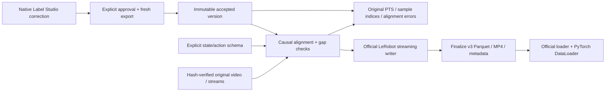

# Convert an accepted export to LeRobot

The adapter uses official LeRobot 0.6.1 to create, save, finalize and load a local v3 dataset. It converts an immutable accepted project export, preserving native annotation and prediction origins, outcome, quality flags, notes, audit history and original clocks. It does not infer robot joint names or action semantics.



## Isolated runtime

Label Studio and training dependencies have independent lockfiles. The dataset runtime installs the `dataset` extra, without policy models, hardware drivers or accounts. Linux uses official PyTorch CPU wheels; macOS resolves its normal wheels. These dataset checks run on Linux CPU. The [MLX adapter](mlx.md) has its own environment and verification commands.

```bash
# Repository root; Python 3.12, uv 0.12.23 and FFmpeg required:
uv sync --locked --project integrations/lerobot
export HF_HOME="$PWD/.cache/huggingface"
export HF_HUB_OFFLINE=1
export HF_HUB_DISABLE_TELEMETRY=1

uv run --locked --project integrations/lerobot python -m robo.lerobot_export \
  --accepted artifacts/accepted-v1 \
  --source-root data/local \
  --schema integrations/lerobot/synthetic-schema.json \
  --split train \
  --output artifacts/lerobot-v1-train
```

Use the example schema only with the generated illustration. For real data, supply the declared robot type, target FPS/image dimensions, maximum permitted video age, and ordered state/action components. Each component names a source stream, column index, name, units and meaning. Source modality and units must match exactly. Missing streams, missing initial samples, gaps beyond tolerance, invalid dimensions and float32 overflow fail conversion. No zero filling, fabricated values, automatic normalization or inferred control representation is performed.

## Timestamp and split contract

| Item | Policy |
| --- | --- |
| Training clock | LeRobot generates `timestamp = frame_index / fps`; derived training times, not measured capture times |
| Video mapping | Latest source frame at/before each grid point, using integer PTS and rational time base, with only 1 ns rounding allowance |
| State/action mapping | Latest sample at/before the grid point after its declared offset, within that stream's tolerance; no interpolation or future commands |
| Fidelity | Target FPS may omit/repeat source frames. Alignment JSON reports both counts, ages and final-frame duration rounding. No arbitrary-PTS lossless claim |
| Video transform | One camera, explicit area-interpolation resize, RGB → H.264 CRF18/yuv420p; a lossy derivative |
| Annotation | Half-open segments sampled on the grid; unlabeled points stay `unknown`. Exact accepted boundaries and native evidence remain in provenance |
| Split | Each output contains exactly one requested split. Existing accepted-export session/media leakage gates remain authoritative |
| Freshness | Conversion reads a historical accepted version and makes no new native freshness assertion. For current decisions, first create a fresh export through the approval bridge |

The encoder receives a bounded queue of two frames; source decoding is sequential with one retained image. LeRobot buffers numeric samples/metadata per episode. Pilot limits remain one camera, at most 300 seconds/20,000 source frames per episode. Conversion is local, never uploads to the Hub, verifies media/manifest hashes before and after encoding, and publishes the completed directory by rename. Repeating conversion checks all output hashes and reuses the version; a different schema or corrupted output is rejected.

## Consume the dataset

Run in the isolated runtime with the cache/offline variables above:

```python
from pathlib import Path
from lerobot.datasets.lerobot_dataset import LeRobotDataset
from torch.utils.data import DataLoader
from robo.lerobot_export import validate_training_export

root = Path("artifacts/lerobot-v1-train")
manifest = validate_training_export(root)
dataset = LeRobotDataset(
    f"local/{manifest['version']}",
    root=root,
    video_backend="torchcodec",
    delta_timestamps={"action": [0, 1 / manifest["schema"]["fps"]]},
)
batch = next(iter(DataLoader(dataset, batch_size=4, num_workers=0)))
```

`observation.state` and `action` retain schema order as float32. `observation.images.source` loads as CHW float32 in [0,1]. `source.frame_index` and `source.timestamp` retain original frame identity and absolute PTS seconds. `annotation.subtask` indexes the manifest's vocabulary. Outcome/quality/notes and the full accepted revision remain in `provenance/accepted/episodes.jsonl`, and are not converted into reward targets.

LeRobot 0.6.1 loads shape-(1,) numeric features as scalars. The illustration has one state/action component; the two-component fixture verifies vector batches and action windows. A policy-specific processor must respect actual source dimensions and representation; this adapter does not claim π₀.₅-ready action semantics. LeRobot marks episode-end action-window padding with `action_is_pad`, tested separately from source alignment, which never pads missing measurements.

`provenance/accepted` retains the entire input accepted metadata version, including other splits' metadata, for hash validation; only the chosen split has training rows/video. Treat the dataset as immutable. Hashes establish integrity, not signatures or a replacement for trusted storage.

LeRobot internally calls its local table split `train`, including when writing a held-out directory. The authoritative project split is `provenance/manifest.json` → `split`; select the corresponding output directory explicitly for training or evaluation. The test split is separately converted/loaded in the regression test and contains only its held-out episode.

## Verify

```bash
uv run --locked pytest -q tests/test_lerobot_plan.py
uv run --locked --project integrations/lerobot python -m pytest -q integrations/lerobot/test_roundtrip.py

# Choose unused paths; the smoke never overwrites a fixture:
ROBO_NATIVE_EXPORT_FIXTURE=artifacts/native-training-fixture \
  uv run --locked python -m scripts.labelstudio_smoke --browser
uv run --locked --project integrations/lerobot python -m integrations.lerobot.verify_native \
  artifacts/native-training-fixture artifacts/native-lerobot
```

CI transfers the actual browser/SDK smoke's accepted synthetic artifact and media to a separate LeRobot job. It checks 96 training rows, decoded images, native outcome/quality, the corrected 0.5-second boundary, original PTS, repeat conversion and a DataLoader batch. It transfers no Label Studio database, session or credential. [Recorded run](evidence/lerobot-roundtrip.json).

The [real DROID pilot](droid.md) passed native correction, approval, export and official LeRobot loading for 119 steps. Its nominal 15 Hz timing is inferred; its state/action representation is explicitly seven joint positions plus gripper closure. All loaded vectors are checked against decoded RLDS, with zero omitted/repeated frames. `source.timestamp` is stored as float64 in Parquet but the official torch transform loads it as float32; integer frame identity and exact mapping remain in provenance. [Real-data evidence](evidence/droid-roundtrip.json).

Dataset conversion does not establish policy quality. See the [MLX guide](mlx.md) for the tested action-expert training path and its remaining pretrained and hardware requirements.

Sources: [official LeRobot v3 format](https://huggingface.co/docs/lerobot/lerobot-dataset-v3), [pinned PyPI release](https://pypi.org/project/lerobot/0.6.1/), [official TorchCodec compatibility](https://github.com/meta-pytorch/torchcodec#compatibility-with-torch-versions). The installed 0.6.1 API is exercised directly.
