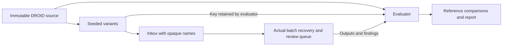

# Test recovery with controlled DROID corruptions

This benchmark takes one real, 119-step DROID episode and creates 16 isolated variants. It measures whether the batch pipeline repairs cases with enough evidence, flags incomplete data and rejects ambiguous inputs. The original episode stays unchanged. These are synthetic perturbations of real data, not recordings collected in naturally messy conditions.

## Run it

Download and convert the pinned sample using the [DROID guide](droid.md), then run:

```bash
uv run --locked python -m scripts.messy_droid \
  data/local/droid-converted/source.json artifacts/messy-droid
```

Use `--seed 7` and a different output directory for another ordering. The command runs the real batch CLI twice and compares its reports and input hashes. Reusing an output directory requires the same seed, source hashes and unchanged inputs. A changed input stops the run; it is never silently regenerated.

Outputs stay in the ignored `artifacts/` directory:

| Path | Contents |
| --- | --- |
| `inbox/` | Randomly named episode directories, manifests and derived videos |
| `work/` | Normalized manifests, immutable imports, suggestions, review bundles and batch reports |
| `evaluation/cases.json` | Exact corruption operations, permutations, retained indices and input hashes |
| `report.json` | Per-case comparisons, errors, retention counts and aggregate results |

The recovery subprocess receives only the inbox and work directory. The evaluator holds the corruption key in memory while recovery runs and writes it afterward. Recovery never imports the benchmark module or reads the clean reference. This separation prevents the test from supplying missing timestamps or values to the repair algorithm; it is not a security sandbox for arbitrary code.



## Results

The [recorded run](evidence/messy-droid.json) used seed 2026. A second run with seed 7 produced the same aggregate counts. Both runs repeated the batch without changing its report or input files.

| Input | Cases | Result |
| --- | ---: | --- |
| Clean controls | 2 | Unchanged; no corruption findings |
| Shuffled rows/files, exact duplicates, declared clock offset, combined case | 4 | Fully repaired; all original samples and frames retained |
| Missing middle frame, missing first frame, missing numeric samples | 3 | Prepared for review; training alignment blocked |
| Conflicting duplicates, unknown clock, missing offset/license, invalid units, truncated media, out-of-range offset | 7 | Rejected with a reason; not counted as repaired |

All 14 corrupted cases were detected, with zero false positives among the two controls and zero silent corruptions under these tests. The four repaired cases had exactly matching numeric features, video-frame mappings and all 119 original frames. Declared offsets restored sample times to within floating-point rounding. The benchmark checks decoded images with a normalized mean absolute error threshold of 0.02 to allow the deliberate H.264 re-encoding in frame-drop cases.

Across nine prepared episodes, 1,069 video frames and 4,272 numeric sample rows remained. Two frames and 12 sample rows were missing in the incomplete variants. The seven rejected episodes represent another 833 reference frames and 3,332 sample rows excluded from output. Their source files still exist; exclusion is not data repair.

Dropping the first frame exposed a 0.066667 s origin shift after video normalization. The pipeline flags that ambiguity and blocks training conversion until the clock origin is resolved. It does not guess a new offset. A missing middle frame fails the causal video check, and missing numeric rows fail the same sample-age checks used by the LeRobot converter.

## What recovery does

Batch intake sorts paired timestamps and values, removes only exact duplicate rows and records each change. Different values at the same timestamp require an authoritative choice. Every numeric stream must declare `offset_s` and `clock_evidence`; an unknown clock is an input error. No recovery path invents or interpolates samples.

The queue adds reasons for missing aligned samples, gaps in a declared nominal video clock and a nonzero start in a derived video. Variable-frame-rate sources are not assumed to have a regular cadence. Seven rejected inputs need corrected data or metadata, and three incomplete inputs need a data decision: ten data-review requests in total. Nine prepared episodes still need semantic label review. Those counts overlap and must not be added as if they measured distinct human sessions. There were no automatic approvals, and human review time was not measured.

The benchmark covers this specific corruption suite on one episode. It does not establish performance on arbitrary datasets, recover unknown clocks, judge task-label accuracy or measure human time savings. DROID supplies an inferred 15 Hz step clock here, not measured capture timestamps. See the [data contract](data-contract.md) for accepted inputs and the [batch guide](batch-workflow.md) to open prepared episodes in Label Studio.

DROID data: Khazatsky et al. (2024), [DROID](https://droid-dataset.github.io/), [CC-BY-4.0](https://creativecommons.org/licenses/by/4.0/). Raw data, variants and local review sessions are excluded from Git and CI uploads; the committed evidence contains counts, hashes and validation results.
