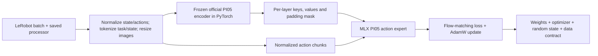

# PI05 action-expert training in MLX

The adapter runs the π₀.₅ action expert in MLX and keeps the official LeRobot vision/language encoder frozen in PyTorch. Images, task text and discretized robot state go through LeRobot's preprocessing. The encoder supplies one key/value cache per transformer layer; MLX uses those caches to predict and train action chunks.

This split works because the prefix cannot attend to action tokens in π₀.₅. With the encoder frozen, caching it preserves the action expert's training objective. It also avoids maintaining a second image encoder and tokenizer implementation.



## Run the checks

From the repository root, using Python 3.12 and uv 0.12.23:

```bash
uv sync --locked --project integrations/mlx_pi
MLX_ENABLE_TF32=0 PYTORCH_ENABLE_MPS_FALLBACK=0 uv run --locked --project integrations/mlx_pi python -m pytest -q integrations/mlx_pi
MLX_ENABLE_TF32=0 PYTORCH_ENABLE_MPS_FALLBACK=0 uv run --locked --project integrations/mlx_pi python -m integrations.mlx_pi.verify --device gpu --output artifacts/mlx-metal.json
```

The separate runtime pins MLX 0.32.4, LeRobot 0.6.1, Transformers 5.5.4 and PyTorch 2.11.0. Linux uses the official `mlx[cpu]` package. On Apple silicon, the same lockfile selects MLX Metal and the macOS PyTorch wheel. On the Mac, model tests use MLX Metal and the official PyTorch encoder and reference use MPS. The checks fail if either GPU backend is unavailable. Host copies still handle checkpoint loading, cache transfer and result serialization.

Set `MLX_ENABLE_TF32=0` before the process starts. MLX otherwise enables reduced-precision float32 matrix multiplication on M5, which failed the existing parity tolerances. This setting retains float32 Metal execution. `PYTORCH_ENABLE_MPS_FALLBACK=0` prevents unsupported reference operations from running on CPU.

## What was verified

[CPU measurements](evidence/mlx-pi05.json) use small configurations of the installed official model, including its SigLIP image encoder, PaliGemma prefix and adaptive Gemma action expert. The action expert has 40,008 parameters, two layers and three-step action chunks. These are random weights, used to compare implementations.

| Check | Measured result |
| --- | --- |
| Flow-matching loss versus official joint forward pass | Absolute error `2.38e-7` |
| All 32 action-expert gradient tensors | Maximum absolute error `2.55e-7` |
| Three Euler sampling steps | Maximum absolute error `2.38e-7` |
| AdamW update with clipping and bias correction | Matches the official PyTorch loss/update within test tolerance |
| Save after step one; resume step two | Loss, optimizer progression and every resulting parameter match exactly |

The [Mac check](evidence/mlx-pi05-metal.json) runs the official encoder and reference on MPS and the action expert on MLX Metal. All 14 tests pass. Loss error is zero, maximum gradient error is `2.57e-7`, sampling error is `2.38e-7`, and checkpoint resume is exact. These remain small random-model checks.

Tests also cover camera/text padding, official image resize and state prompts, shape/layout rejection, action-dimension masking, changed data contracts and corrupted checkpoint files. An invalid loss leaves the parameters and random state unchanged. The trainer uses a constant learning rate; it does not reproduce LeRobot's full training schedule.

## Use the adapter

`prepare_batch` accepts an official `PI05Policy`, its saved preprocessor, and a batch from LeRobot. The preprocessor must contain the correct dataset statistics, camera mapping, action convention and authorized tokenizer. The example below assumes those objects are already loaded locally:

```python
from integrations.mlx_pi.bridge import expert_from_torch, prepare_batch
from integrations.mlx_pi.training import Trainer

expert = expert_from_torch(policy.model)
trainer = Trainer(expert, seed=42)
prefix, actions = prepare_batch(policy, preprocessor, raw_batch)
metrics = trainer.step(prefix, actions, action_dimensions=8)

# Include dataset version, processor/statistics hash, model revision and action schema.
trainer.save("artifacts/run/step1", contract=training_contract)
resumed = Trainer.load("artifacts/run/step1", contract=training_contract)
```

The adapter currently requires float32. Prefix caches use `[batch, kv_heads, tokens, head_dim]` after rotary position encoding. Their padding mask controls both attention and action positions. Moving a prefix from PyTorch to MLX currently copies it through CPU memory. Cache reuse is valid only while the encoder, observations and preprocessing stay fixed.

`weights.load_expert(path)` imports the action tensors from a local official safetensors checkpoint and checks names, shapes and dtype. It leaves the image/text weights and unused language heads out of the MLX model. `expert_from_torch` provides the same conversion for an already loaded official model. Checkpoints store the MLX weights, AdamW state, explicit random key and caller-supplied data/model contract. Files are hashed, and a changed contract or damaged file prevents resume.

## Run full inference with synthetic observations

Download the pinned full checkpoint and its saved processors. The tokenizer comes from the public Google bucket used by [official OpenPI](https://github.com/Physical-Intelligence/openpi/blob/215abfb217dbac7d5f1273282331b9b1866c0479/src/openpi/models/tokenizer.py).

```bash
mkdir -p artifacts/pi05-base
curl -fL --continue-at - https://huggingface.co/lerobot/pi05_base/resolve/22c30e5b34f9e7ab738b1b34fc2fc5ecfe2d28f0/model.safetensors -o artifacts/pi05-base/model.safetensors
curl -fL https://huggingface.co/lerobot/pi05_base/resolve/22c30e5b34f9e7ab738b1b34fc2fc5ecfe2d28f0/config.json -o artifacts/pi05-base/config.json
curl -fL https://huggingface.co/lerobot/pi05_base/resolve/22c30e5b34f9e7ab738b1b34fc2fc5ecfe2d28f0/policy_preprocessor.json -o artifacts/pi05-base/policy_preprocessor.json
curl -fL https://huggingface.co/lerobot/pi05_base/resolve/22c30e5b34f9e7ab738b1b34fc2fc5ecfe2d28f0/policy_postprocessor.json -o artifacts/pi05-base/policy_postprocessor.json
curl -fL https://storage.googleapis.com/big_vision/paligemma_tokenizer.model -o artifacts/pi05-base/tokenizer.model
MLX_ENABLE_TF32=0 PYTORCH_ENABLE_MPS_FALLBACK=0 HF_HUB_OFFLINE=1 uv run --locked --project integrations/mlx_pi python -m integrations.mlx_pi.infer_synthetic artifacts/pi05-base --output artifacts/pi05-synthetic-metal
```

The command starts with generated camera images, a fake 32-value state and task text. It runs the saved official preprocessor with explicit synthetic quantile statistics, then checks the task/state tokens against the original SentencePiece model. Official image processing and the full frozen encoder run on MPS. The pretrained MLX action expert runs all ten Euler steps on Metal. The saved official postprocessor converts the full 50-step action chunk with the same synthetic statistics.

The reference uses the official policy's full inference entry point on MPS with identical observations and noise. Both paths must produce finite action chunks and agree within the fixed float32 tolerances. The command saves raw and processed inputs, actions and a JSON report under the output directory. It writes a success report only after all checks pass. No DROID data or robot connection is used.

The [recorded M5 Pro run](evidence/pi05-synthetic-metal.json) passes the complete flow with all three cameras and 138 task/state tokens. All 812 checkpoint tensors load strictly, with one additional state key for the tied input embedding. The full weight-file hash matches the official pinned LFS hash. Both complete `[1, 50, 32]` action chunks are finite. Maximum error against MPS is `6.11e-7` before postprocessing and `2.98e-7` afterward, below the unchanged `5e-5` absolute and relative tolerances. The [saved action arrays](evidence/pi05-synthetic-actions.npz) contain both normalized and postprocessed outputs. This is an inference correctness check with synthetic observations and statistics, not a policy-quality or performance benchmark.

## Checkpoint and DROID compatibility

The chosen checkpoint is [`lerobot/pi05_base`](https://huggingface.co/lerobot/pi05_base/tree/22c30e5b34f9e7ab738b1b34fc2fc5ecfe2d28f0). Its 14,467,165,872-byte file was inspected through HTTP range requests. All 208 action-expert tensor shapes match the adapter's full configuration: width 1024, 18 layers, 8 query heads, one key/value head, head dimension 256, 32 action dimensions and a 50-step chunk. Those tensors contain 430,098,464 parameters. Shape compatibility alone does not establish pretrained output parity.

The earlier [inspection evidence](evidence/pi05-checkpoint.json) records the pinned revision and checksums. That inspection read 135,920 bytes from the weight file, including its header and a 128-byte output bias. The full inference check above downloads and loads the complete checkpoint. Reproduce the earlier bounded inspection with:

```bash
uv run --locked --project integrations/mlx_pi python -m integrations.mlx_pi.inspect_checkpoint artifacts/pi05-inspection
```

The DROID export contains seven absolute joint positions in radians and one gripper closure fraction, with 0 open and 1 closed. `validate_droid_schema` rejects velocity fields, reordered joints, different units and implicit checkpoint mappings. The base PI05 model does not establish robot-specific semantics. Fine-tuning therefore needs an explicit action contract and statistics fitted to the chosen training split. The current one-episode DROID pilot uses an inferred 15 Hz clock and incomplete automated review labels; it cannot establish policy quality.

## Remaining pretrained and hardware checks

The public PI05 weight file is ungated. Earlier requests for Google's Hugging Face tokenizer files returned HTTP 401. The full inference check uses the public Google SentencePiece asset that official OpenPI downloads anonymously. Its task/state tokens match direct SentencePiece encoding. The runner loads all assets locally and makes no tokenizer request to Hugging Face. [Source and license details](../integrations/mlx_pi/NOTICE.md) distinguish the Apache implementation from the Gemma assets.

Small-model checks and full pretrained synthetic inference now pass on MPS and MLX Metal. Pretrained training, peak memory use, sustained speed and model quality remain unmeasured. The run does not establish robot-specific action semantics or dataset statistics. Mixed precision, quantization and training the vision/language encoder are outside this adapter's current scope.
