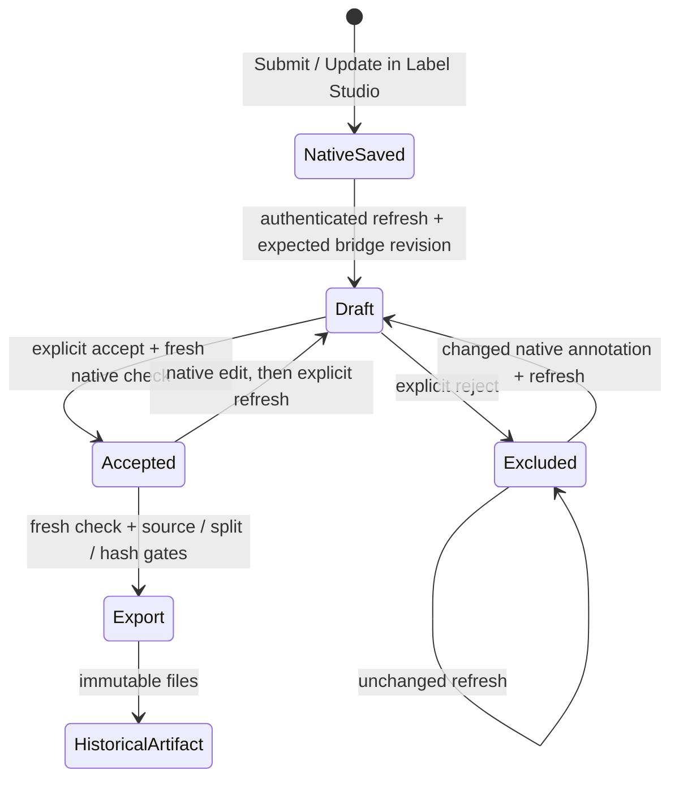

# Native review to accepted export

Label Studio owns annotation editing and saving. The bridge records a separate decision about whether that saved annotation may enter a training export. It uses the local revision store and official SDK.



## Operator workflow

Prepare and import the task as described in the [native GUI guide](labelstudio.md). Preparation writes `bundle.json` alongside the import JSON, XML and mapping. Keep that original bundle: it binds the source, task data, review clock and immutable machine suggestions.

The examples use `data/local/work`, matching the batch guide. Use your actual store path throughout. If `batch sync` already published the task, its binding exists; skip `bind` and start with `refresh`.

The CLI requires an existing authorized credential in `LABEL_STUDIO_API_KEY` and defaults to `http://127.0.0.1:8000`. It neither creates nor stores a credential. Python callers can instead supply an already authenticated official SDK client/session to `NativeReviewBridge`, as the integration test does. Live bridge requests are restricted to loopback origins. Offline inspection requires no credential.

```bash
# After manual project/task import, register their actual native IDs once:
uv run --locked python -m robo --store data/local/work native-review bind \
  artifacts/labelstudio-bundle/bundle.json --project PROJECT_ID --task TASK_ID

# Submit the correction in Label Studio, then choose its annotation ID explicitly:
uv run --locked python -m robo --store data/local/work native-review refresh EPISODE_ID \
  --annotation ANNOTATION_ID --expected-revision 0 \
  --actor reviewer --reason 'Imported saved correction for approval'

uv run --locked python -m robo --store data/local/work native-review inspect EPISODE_ID
uv run --locked python -m robo --store data/local/work native-review accept EPISODE_ID \
  --expected-revision 1 --actor approver --reason 'Checked video, boundaries and quality flags'
# Use `reject` instead of `accept` to exclude this exact draft.

# selection.json: [{"episode_id":"ACTUAL_EPISODE_ID","revision":2,"split":"train"}]
uv run --locked python -m robo --store data/local/work native-review export selection.json artifacts/accepted-v1 \
  > artifacts/accepted-v1-receipt.json
uv run --locked python -m robo validate-export artifacts/accepted-v1
```

Use `inspect` to obtain the actual revision after any prior operation; the numbers above assume a fresh store. The approver string is a local operator assertion, not an enterprise identity or proof of independent adjudication. The native annotation's actual reviewer ID is recorded separately.

## Freshness rules

A binding identifies one local instance, project and task. Registration checks the labeling configuration, source and proxy hashes, task data and machine predictions. Repeating the same binding is safe; replacing it is rejected. Batch bindings allow only queue priority and reason to change. A different review grid or machine origin requires a new prepared task.

Refresh reads the chosen submitted annotation through the SDK and validates its timeline, outcome, quality flags and notes. Missing outcome stays `unknown`. Unsaved drafts, cancelled annotations, unknown controls, unbound predictions and changed prediction contents are rejected.

Accept and reject require the expected local revision and recheck native content. A stale revision fails. A native edit or resave must become a new local draft before approval, and uncertainty must be resolved before acceptance. Reading unchanged content creates no revision and preserves an existing acceptance or rejection.

Every new export request rechecks the selected native annotation and machine origin, including a repeat export to an existing directory. A failed native read blocks the request. The legacy path cannot bypass these checks for a bound episode.

The bridge reads the task and project configuration again after retrieving the annotation to detect changes during the request. These reads do not form a transaction across Label Studio and SQLite. Finish concurrent editing before approval or export. A change after the last read is detected on the next operation; unsaved browser edits and intermediate native autosaves are outside the local audit.

Existing export files remain historical snapshots. Later edits block new exports but do not rewrite old files. `validate-export` works offline. Unchanged exports have the same dataset version; the fresh-read receipt is returned separately from the immutable dataset.

## Timing and provenance

Each revision carries its native annotation ID/content, reviewer ID, machine prediction IDs/versions/results, original source binding, label-configuration hash, review-grid policy and measured-source boundary brackets. Approval retains the same snapshot hash. Changing the active local inference run does not rebind accepted evidence.

Native `lead_time` is retained as `native_lead_time_s`, including on repeated saves. It is not summed across revisions or relabeled as active human effort. Native revisions use `active_s: null`, `wall_s: null` and `timing_source: native_active_time_unmeasured`. The evaluator lists these episodes as unmeasured and excludes their incomplete histories from efficiency statistics. Bridge timestamps measure system events only. The manual/assisted field records whether the bound task offered predictions, not a randomized study assignment or measured suggestion usage.

## Verification

The full native smoke first edits the actual browser timeline, sets failure/recovery, writes evidence, submits and reloads. The official SDK then imports a draft, explicitly accepts it, exports twice, changes the native annotation, rejects a stale export, validates the historical artifact, imports the new draft and rejects it. The test does not create persistent API credentials. Unit tests additionally exercise stale revisions, concurrent-read changes, empty/unknown fields, changed configuration/predictions, rejected drafts, timestamp normalization/regression and unmeasured timing.

```bash
uv run --locked pytest -q
LS_TASK_LOADING_CONTRACT=1 LS_CPU_RATE=6 \
  uv run --locked python -m scripts.labelstudio_smoke --browser
```

The default fixture uses synthetic video. The [DROID demo](demo.md) exercises the same path on real footage. Both use automated test decisions. The SDK calls follow the official [task](https://api.labelstud.io/api-reference/api-reference/tasks/get) and [annotation](https://api.labelstud.io/api-reference/api-reference/annotations/get) contracts.
