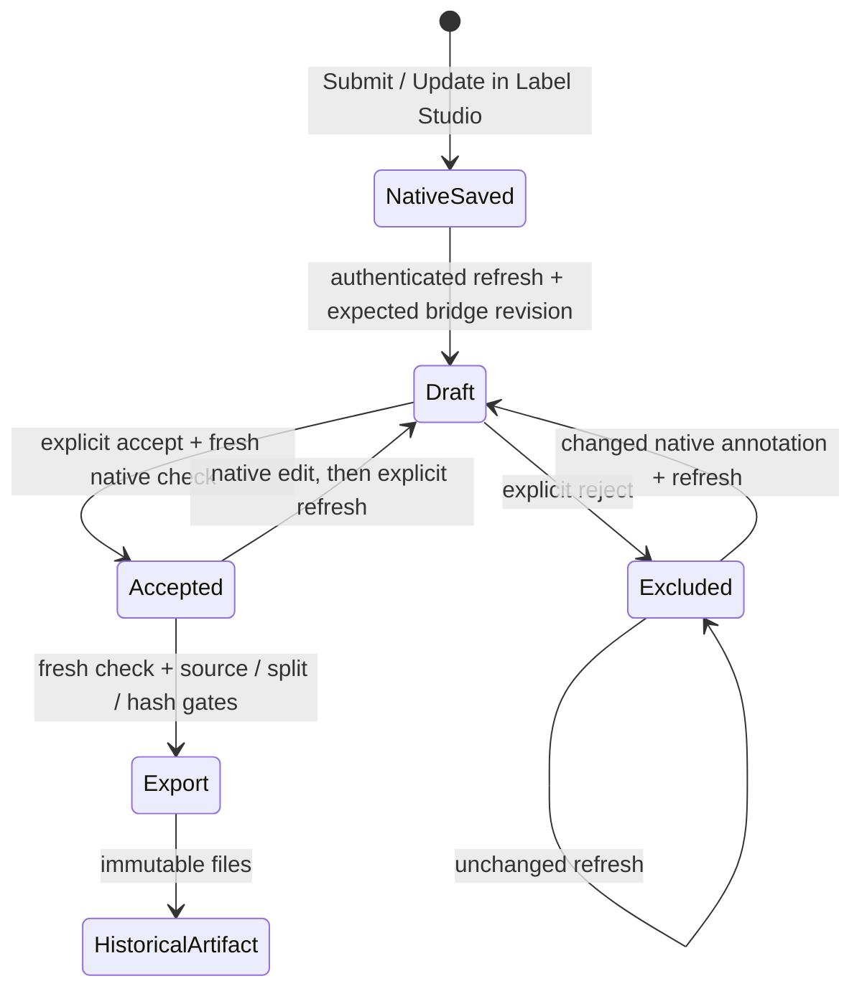

# Native review to accepted export

Label Studio owns annotation editing and saving. The bridge now owns an explicit second decision: whether that exact saved annotation may enter a training export. This uses the existing immutable revision store and the official SDK, without adding another annotation UI or using Enterprise review features.



## Operator workflow

Prepare/import the task as described in the [native GUI guide](labelstudio.md). Preparation now writes `bundle.json` alongside the import JSON, XML and mapping. Keep that original bundle: it binds the source, task data, review clock and immutable machine suggestions.

The CLI requires an **existing** authorized credential in `LABEL_STUDIO_API_KEY` and defaults to `http://127.0.0.1:8000`. It neither creates nor stores a credential. Python callers can instead supply an already authenticated official SDK client/session to `NativeReviewBridge`, as the integration test does. Live bridge requests are restricted to loopback origins. Offline inspection requires no credential.

```bash
# After manual project/task import, register their actual native IDs once:
uv run --locked python -m robo native-review bind \
  artifacts/labelstudio-bundle/bundle.json --project PROJECT_ID --task TASK_ID

# Submit the correction in Label Studio, then choose its annotation ID explicitly:
uv run --locked python -m robo native-review refresh EPISODE_ID \
  --annotation ANNOTATION_ID --expected-revision 0 \
  --actor reviewer --reason 'Imported saved correction for approval'

uv run --locked python -m robo native-review inspect EPISODE_ID
uv run --locked python -m robo native-review accept EPISODE_ID \
  --expected-revision 1 --actor approver --reason 'Checked video, boundaries and quality flags'
# Use `reject` instead of `accept` to exclude this exact draft.

# selection.json: [{"episode_id":"ACTUAL_EPISODE_ID","revision":2,"split":"train"}]
uv run --locked python -m robo native-review export selection.json artifacts/accepted-v1 \
  > artifacts/accepted-v1-receipt.json
uv run --locked python -m robo validate-export artifacts/accepted-v1
```

Use `inspect` to obtain the actual revision after any prior operation; the numbers above assume a fresh store. The approver string is a local operator assertion, not an enterprise identity or proof of independent adjudication. The native annotation's actual reviewer ID is recorded separately.

## Freshness contract

- A binding is immutable and scoped to the local instance, project and task. Registration verifies the prepared labeling configuration, video/proxy hashes, task data and machine prediction contents. Repeated registration of the same binding is harmless; replacing it is rejected. Changing model provenance or the review grid requires a separately prepared task/store workflow; automatic rebinding is deliberately unsupported in this slice.
- Refresh reads the chosen submitted annotation through the SDK. It validates timeline spans, Outcome, Quality and reviewer notes. Missing Outcome remains `unknown`. Visible native autosave drafts, cancelled/rejected annotations, unknown controls, unbound parent predictions and changed machine predictions fail closed.
- Accept/reject names the exact expected bridge revision and rechecks native content. SQLite serializes bridge decisions; a stale expected revision fails. A changed native annotation, including a resave with a newer timestamp, must be imported as a new draft before approval. Uncertainty must be resolved before acceptance. Re-importing unchanged content does not create a revision, erase a rejection or invalidate an unchanged acceptance.
- Every **new export request**, including a repeat to an existing output directory, rechecks the selected native annotation and immutable machine origin. The legacy export/approval path cannot bypass this check for a bound episode. Native read failure means no new approval/export.
- The bridge reads the task again after retrieving the annotation, and checks the project configuration again, to detect changes during observation. It records the observation time, native version timestamp and content hash. This is **not a transaction across Label Studio and SQLite**. Finish/close concurrent editing before approving or exporting. Unsaved edits not exposed by the authenticated API are outside the observation. Changes after the last read are detected on the next refresh/approval/export; there is no webhook or background invalidation claim.
- The audit contains imported snapshots and explicit bridge decisions, not every intermediate native autosave. Concurrent-editor save behavior remains Label Studio's own; the bridge does not add a browser save lock or claim to prevent a stale native tab from saving.
- Existing export files are historical snapshots. Later edits block new export eligibility; they do not rewrite, delete or invalidate the hashes of a previously published artifact. `validate-export` deliberately works offline. Repeated unchanged exports have the same dataset version; fresh-read receipts are returned separately from immutable dataset contents.

## Timing and provenance

Each revision carries its native annotation ID/content, reviewer ID, machine prediction IDs/versions/results, original source binding, label-configuration hash, review-grid policy and measured-source boundary brackets. Approval retains the same snapshot hash. Changing the active local inference run does not rebind accepted evidence.

Native `lead_time` is retained as `native_lead_time_s`, including on repeated saves. It is not summed across revisions or relabeled as active human effort. Native revisions use `active_s: null`, `wall_s: null` and `timing_source: native_active_time_unmeasured`. The evaluator lists these episodes as unmeasured and excludes their incomplete histories from efficiency statistics. Bridge timestamps measure system events only. The manual/assisted field records whether the bound task offered predictions, not a randomized study assignment or measured suggestion usage.

## Verification

The full native smoke first edits the actual browser timeline, sets failure/recovery, writes evidence, submits and reloads. The official SDK then imports a draft, explicitly accepts it, exports twice, changes the native annotation, rejects a stale export, validates the historical artifact, imports the new draft and rejects it. The test does not create persistent API credentials. Unit tests additionally exercise stale revisions, concurrent-read changes, empty/unknown fields, changed configuration/predictions, rejected drafts, timestamp normalization/regression and unmeasured timing.

```bash
uv run --locked pytest -q
LS_TASK_LOADING_CONTRACT=1 LS_CPU_RATE=6 \
  uv run --locked python -m scripts.labelstudio_smoke --browser
```

This is synthetic software verification, not a human efficiency study or real-DROID result. The SDK calls follow the official [task](https://api.labelstud.io/api-reference/api-reference/tasks/get) and [annotation](https://api.labelstud.io/api-reference/api-reference/annotations/get) contracts.
