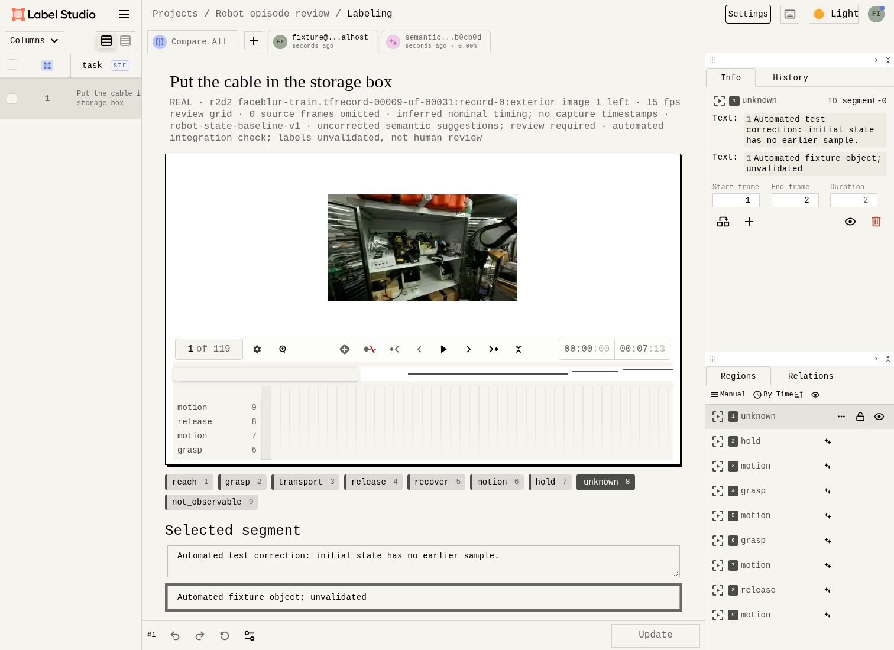
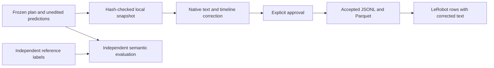

# Review semantic segments in Label Studio

A semantic review task shows the model's subtask text beside its temporal regions. Wait for the video and its full frame count to load, then select a region to edit its text, optional object description, action label or start/end frame. Label Studio saves the correction; the existing bridge makes the separate approval decision.



This is an automated integration test on real DROID footage by Khazatsky et al. (2024), under [CC-BY-4.0](https://creativecommons.org/licenses/by/4.0/). The displayed text and object correction are test inputs, not validated labels. The episode has 119 frames on an inferred 15 Hz clock; capture timestamps were not supplied.

## Keep predictions and corrections separate



Preparation copies the exact plan and prediction bytes under `STORE/semantic_sources`. Registration checks the native prediction's text, ranges, score and model version against that snapshot. Later corrections stay in the native annotation and accepted revision. They are marked `model_assisted_review` with `prediction_exposure: true`, and cannot substitute for the independent references used by the [semantic evaluator](semantic-evaluation.md).

A text-only edit changes the review snapshot, so it requires a fresh draft and approval before another export. Original prediction files and historical accepted exports remain unchanged. The frozen plan's split also follows the correction into export: a test episode cannot be selected as training data.

## Prepare and review an episode

Start with an imported episode, its [evaluation plan](semantic-evaluation.md), and predictions from the [state baseline](semantic-state-baseline.md) or [local Qwen adapter](qwen-semantic-adapter.md). Use a store where this episode is not already bound to a different native task. To compare a different model run after binding, import the source into a separate review store and keep the previous store intact.

```bash
uv run --locked python -m robo.semantic_review \
  --store data/local/droid-work \
  --plan artifacts/semantic/plan.json \
  --predictions artifacts/state-predictions/predictions.json \
  --episode EPISODE_ID --output artifacts/semantic-review
```

The directory contains `tasks.json`, `review.xml`, `mapping.json`, `provenance.json` and `bundle.json`. Repeating the command verifies and reuses identical files. A different preparation needs a new output directory. The current semantic adapter requires a one-to-one source/review frame grid and the existing coarse action vocabulary; it rejects a lossy projection or unsupported action.

Use the [Label Studio setup](labelstudio.md#open-a-review-project) to import `tasks.json` with `review.xml`, or pass the returned bundle to `publish_bundle()` with an already authenticated official SDK client. Register the task with its actual project and task IDs:

```bash
uv run --locked python -m robo --store data/local/droid-work native-review bind \
  artifacts/semantic-review/bundle.json --project PROJECT_ID --task TASK_ID
```

Open the project table and click the task row. Select the prediction and **Create an annotation**. Select a region, edit **Selected segment**, and check its action and boundaries. An absent object description means the object is unknown; it need not be invented. To remove a previous description, clear the object field and save the annotation. The bridge exports it as `null`; LeRobot stores an empty string with `object_present: false`. Submit, then use the [refresh, inspect, accept and export commands](native-approval.md#operator-workflow) with this store. Use the split from the frozen plan in `selection.json`.

Every accepted region needs nonblank subtask text. Regions must cover all source frames without gaps or overlap. Partial corrections can be saved as drafts. Represent a span that cannot be interpreted with an explicit `unknown` or `not_observable` label and a description of the uncertainty. Approval is an operator decision; preparation never approves a candidate. A failed prediction opens an empty review task with its error visible. The bridge accepts a complete manual annotation while preserving the failed prediction record; that contract has a generated regression test. Creating the entire annotation from scratch in the native UI has not yet been exercised by the browser test.

This command prepares one semantic task at a time. The ordinary batch workflow still prepares its existing coarse motion suggestions. Neither path supplies independent ground truth.

## Export frame-aligned text

Run the [LeRobot conversion](lerobot.md) on the accepted version, using the same source store, explicit robot schema and frozen split. For the pinned DROID pilot:

```bash
uv run --locked --project integrations/lerobot python -m robo.lerobot_export \
  --accepted artifacts/accepted-semantic \
  --source-root data/local/droid-work \
  --schema data/local/droid-converted/training-schema.json \
  --split test --output artifacts/semantic-lerobot
```

| Feature | Value in each loaded row |
| --- | --- |
| `annotation.subtask` | Corrected action label ID in the existing vocabulary |
| `annotation.subtask_text` | Corrected subtask text for `source.frame_index` |
| `annotation.object_text` | Corrected object text, or an empty string when absent |
| `annotation.object_present` | Whether an object description was supplied |
| `task` | Original episode instruction |

Text follows the selected source frame, so deliberately repeated video frames repeat their text too. Accepted provenance retains the original predictions, correction, approval and split. Semantic exports use adapter version 2; exports without semantic text retain version 1. Export the two kinds separately. The converter rejects a mixed selection rather than losing text.

These are annotation features available to downstream code. Adding them does not change a policy's conditioning or establish that an existing checkpoint consumes them. DROID's absolute joint/gripper action schema and the existing [PI compatibility checks](mlx.md) still apply.

## Reproduce the integration check

After the [DROID demo setup](demo.md) and [browser setup](development.md):

```bash
ROBO_SEMANTIC_EXPORT_FIXTURE=artifacts/semantic-native-fixture \
  uv run --locked python -m scripts.labelstudio_smoke --semantic \
  --source data/local/droid-converted/source.json

uv run --locked --project integrations/lerobot python -m integrations.lerobot.verify_semantic \
  data/local/droid-converted artifacts/semantic-native-fixture artifacts/semantic-lerobot
```

Choose a fresh fixture path for each browser run. The test produces nine baseline candidates, edits text/object fields and two adjacent boundaries in the real application, and saves and reloads. It then clears one saved object description, saves and reloads again, explicitly approves through the SDK bridge, and exports. The neighboring region keeps its object text. A later text-only edit must block a new export. The official LeRobot writer, loader and DataLoader then check all 119 rows, including corrected strings, object presence, source-frame mapping, image decoding and exact float32 state/action values from RLDS. Original prediction hashes must match throughout.

[Recorded evidence](evidence/semantic-review.json) describes this one-episode check. It measures neither semantic accuracy nor human effort. Full pretrained Qwen labeling and comparison against independently verified temporal references remain separate gates.

The browser test also holds video requests during reload, verifies that media is still unloaded, then releases them and waits for playback readiness before selecting the saved region. Frame controls must expose the full source length before use. This covers a CI failure where the native end-frame field initially had a maximum of 1; the pinned editor clamps inputs on click/blur. Stored API ranges are checked before and after reload as well as in the editor. CI runs this path at 6× CPU throttling.
