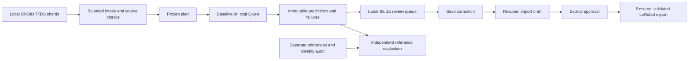

# A resumable semantic workflow

One command now connects local DROID intake, a label-free plan, the chosen semantic provider, native review tasks and versioned LeRobot export. Run it again after saving or approving annotations. It reuses the original predictions, refreshes saved corrections into drafts, and exports only fresh accepted revisions.



The orchestrator calls the existing isolated runtimes and native bridge. It does not run the legacy OpenCV batch suggester, create another editor, or choose a replacement provider when inference fails. Routing uses failures, coverage gaps, unknown actions and declared uncertainty without reading reference labels. Every task still needs explicit approval; uncertainty is not calibrated accuracy.

## Prepare once

From the repository root, install the existing locked runtimes:

```bash
./scripts/setup.sh
uv sync --locked --project integrations/droid
uv sync --locked --project integrations/lerobot
```

Use a local TFDS directory containing `dataset_info.json`, `features.json` and DROID TFRecord shards. The [intake guide](droid-local-intake.md) describes the supported layout and byte limits. This command does not download data. The example below uses the existing one-episode pilot; `allow_partial` acknowledges its missing shards.

Save this as `artifacts/semantic-workflow.json`. Paths resolve from the directory where you run the command. Choose `train` only for training inputs; choose `development` or `test` for the corresponding evaluation population. That choice is frozen for this workspace.

```json
{
  "source": "data/local/droid-sample",
  "release": "droid_100/1.0.0",
  "guidelines": "docs/semantic-guidelines.md",
  "provider": "baseline",
  "camera": "exterior_image_1_left",
  "source_split": "train",
  "split": "train",
  "max_episodes": 1,
  "allow_partial": true,
  "instance": "http://127.0.0.1:8000"
}
```

Start the existing Label Studio server for this workflow's store:

```bash
uv run --locked python -m robo --store data/local/semantic-workflow/store serve
```

Open the local app and use your existing local setup/login. In another terminal, supply your existing authorized `LABEL_STUDIO_API_KEY` as described in the [native bridge guide](native-approval.md#operator-workflow). The orchestrator does not create or store a credential. Python callers may instead pass an authenticated official SDK client to `Workflow`.

To select Qwen, set `provider` to `qwen`, add `model_dir` pointing to the pinned local assets, and add an explicit `device`, such as `mps`. Sync `integrations/semantic` and run the [existing asset preflight](mac-semantic-quickstart.md#2-download-and-verify-the-exact-qwen-assets) first. No weights are downloaded by the workflow. A failed Qwen reply remains a failed Qwen prediction; selecting the baseline requires a separate configuration and workspace.

## Run, review, then resume

```bash
uv run --locked python -m robo.semantic_pipeline \
  artifacts/semantic-workflow.json data/local/semantic-workflow
```

Read `data/local/semantic-workflow/report.json`. It contains source counts, prediction failures, review reasons, project links, annotation revisions and export paths. Open the project link, choose **Review priority**, and click a task row. Correct its text or boundaries and save in Label Studio. The [semantic review guide](semantic-review.md) describes the controls.

Run the same command again. A single saved annotation is selected automatically and imported as a draft. If a task has multiple saved annotations, the report asks for an explicit selection through `native-review refresh`; it does not choose arbitrarily. Inspect the draft and accept it explicitly using the actual episode ID and revision from the report:

```bash
uv run --locked python -m robo --store data/local/semantic-workflow/store \
  native-review inspect EPISODE_ID
uv run --locked python -m robo --store data/local/semantic-workflow/store \
  native-review accept EPISODE_ID --expected-revision REVISION \
  --actor reviewer --reason 'Checked the saved text and boundaries against the video'
```

Run the workflow command once more. It selects fresh accepted revisions, validates the accepted export, converts through the official LeRobot writer and validates the resulting files. Its report points to `exports/VERSION` and `training/VERSION`. Repeating an unchanged run preserves those versions. A later native edit creates a new draft and needs fresh approval; historical exports stay unchanged. Rejected annotations remain excluded.

| Exit | Meaning |
| --- | --- |
| `0` | Every review decision is resolved (accepted or excluded), and the accepted subset has a validated training-format export. This is not an accuracy score or a policy-training result. |
| `3` | Waiting for Label Studio access, saved review, annotation selection or explicit approval; also used when all episodes were explicitly excluded and there is nothing to export. The report names the state and any exported subset. |
| `2` | A stage failed or at least one prediction failed. A valid subset may still export; the failed episodes remain in the report. |

A run without an SDK credential can prepare predictions and bundles, but reports `awaiting_label_studio`; it does not claim tasks were published. All-failed inference exits `2`. Empty failed tasks retain their original error and cannot be accepted as complete semantic annotations.

## What resume preserves

The workspace pins configuration, guideline content, provider source/lockfile hashes, per-episode plans and provider manifests. Intake revalidates its original source and converted files before downstream work. Interrupted native imports reconcile existing projects/tasks instead of creating duplicates. The workflow also retains provider training/tuning declarations when combining episode results.

Changed source bytes, prediction files, native predictions or settings block reuse. A provider failure is a saved result, not an invitation to retry silently. After changing a model, prompt or failed input, use a new workspace and keep the failed run for comparison. This first version loads the provider once per episode; it does not keep Qwen resident across a batch. Intake retains its existing bounds of 4,500 steps per episode, 128 MiB per shard and 512 MiB selected shards.

## Evaluation stays separate from correction

The automatically generated plan has an unverified identity audit and contains no gold labels. With no references, the report says evaluation is blocked. To evaluate, supply `audited_plan` and `references` paths in the configuration, following the [semantic evaluation contract](semantic-evaluation.md). The audited plan must match the selected source episodes, guidelines and split. The evaluator rejects missing population entries, disallowed training/tuning overlap and references without the required independence declarations. It evaluates only development or held-out test data.

Scores use the frozen uncorrected predictions, never the native corrections. Supplying an audit is a declaration that must be supported by independent work; the orchestrator cannot establish human verification by itself.

## Verification and limits

The [workflow evidence](evidence/semantic-pipeline.json) records the real 119-frame DROID pilot through baseline prediction, actual Label Studio API review, explicit automated test approval and the official LeRobot loader/DataLoader. Every loaded state/action vector matches the decoded source, and text is checked against source-frame ranges. Repeated runs retain one task and unchanged prediction/export artifacts. The test also checks that Label Studio serves the task's video. DROID is attributed to Khazatsky et al. (2024), under CC-BY-4.0; its pilot clock is inferred at 15 Hz.

Generated fixtures cover multiple episodes, duplicate intake records, partial/all-failed inference, interrupted publication, changed sources/predictions, stale native edits, ambiguous annotation selection and exit codes. They do not establish pretrained labeling quality. The user's separate [Mac evidence](evidence/mac-semantic-e2e.json) covers pretrained Qwen and policy execution; this cloud orchestration check uses the baseline and does not repeat that Mac run. Independent semantic accuracy, human time savings and this new wrapper's full pretrained Mac path remain unmeasured.

To repeat the API and loader check with the existing pilot and installed runtimes:

```bash
uv run --locked pytest -q tests/test_semantic_pipeline.py
uv run --locked python -m scripts.labelstudio_smoke \
  --semantic-pipeline data/local/droid-sample \
  --source data/local/droid-converted/source.json
```

This check uses a disposable local Label Studio database and session. It creates no persistent credential and uploads neither dataset bytes nor model weights. CI publishes only its verification metadata.
