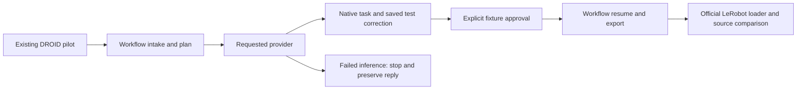

# Check the connected workflow

This acceptance command runs the existing `Workflow` from local DROID intake through provider inference, native Label Studio correction, explicit test approval, export and official LeRobot loading. It supplies one clearly marked test correction through the real SDK and Django backend. It does not open a browser, judge the prediction's meaning or approve production data.



The command defaults to Qwen. It uses the pinned local model through the unchanged semantic runtime, with CPU fallback disabled on MPS. The baseline is a separate explicit option. Neither missing assets nor a failed model reply triggers a replacement provider.

## Prepare the existing inputs

Use the official 119-frame pilot in `data/local/droid-sample`, with `dataset_info.json`, `features.json` and the pinned shard. The [DROID guide](droid.md) describes acquisition if it is not already present. This driver does not download recordings or weights. Its loader comparison is intentionally limited to this pilot.

From the repository root, with Python 3.12, uv 0.12.23 and FFmpeg/FFprobe available, install the locked runtimes once:

```bash
uv sync --locked
uv sync --locked --project integrations/droid
uv sync --locked --project integrations/semantic
uv sync --locked --project integrations/lerobot
```

Supply the exact local Qwen assets described in the [Mac quickstart](mac-semantic-quickstart.md#2-download-and-verify-the-exact-qwen-assets). The command checks their sizes and hashes, and probes the requested device before inference. There is no need to create a plan, imported store, Label Studio project or API token by hand.

## One Mac command

Replace `PATH_TO_PINNED_QWEN` with the existing model directory. Choose a fresh output directory:

```bash
uv run --locked python -m scripts.semantic_workflow_acceptance \
  --source data/local/droid-sample --allow-partial \
  --model-dir PATH_TO_PINNED_QWEN --device mps \
  --approve-fixture --output artifacts/mac-workflow-acceptance
```

`--approve-fixture` explicitly authorizes one automated test correction and approval in a disposable local backend. The text says it is an unvalidated integration input. Without this flag the command stops before inference or review mutations. The ordinary [operator workflow](semantic-workflow.md) still waits for a person's decision; it does not use this test approval.

The driver saves the correction, reads it back through fresh SDK requests, resumes into an unaccepted draft, then explicitly accepts that revision. Subsequent resumes must retain one task, unchanged original predictions and the same validated export. The official LeRobot loader compares all 119 state/action vectors with the source and checks each frame's corrected text, object and action label. The report records the available video decoder. No policy training runs here.

The generated plan uses the development split and an unverified identity audit. `--split train` is available for a separate training-fixture export; it does not make the pilot independent benchmark data.

## Read the result

| Artifact under the output directory | What it establishes |
| --- | --- |
| `report.json` | Overall status, each stage, model execution, fixture decisions, export paths and loader checks. |
| `configuration.json`, `model-preflight.json` | Requested inputs and verified Qwen assets/device. Baseline runs have no model preflight file. |
| `workflow-first.json` | The first production workflow result, before any fixture correction or approval. |
| `workflow/plan.json`, `workflow/predictions.json` | Label-free source plan and frozen uncorrected predictions. |
| `workflow/jobs/` | Per-episode provider manifests, raw replies or failure records and runtime logs. |
| `saved-annotation.json` | Reloaded native correction and the unchanged machine prediction identities. |
| `workflow/exports/`, `workflow/training/` | Versioned accepted annotations and LeRobot files. |
| `loader.json` | Actual loader/DataLoader and source-frame comparisons. |
| `backend.log`, `workflow/logs/` | Local backend and conversion diagnostics. |

Later-stage artifacts are absent when an earlier stage did not finish. Exit `0` means the requested execution and integration checks passed. Exit `2` means a stage failed; `3` means prerequisites were unavailable or fixture approval was not authorized. Always read `model_execution`: a passing baseline check records it as **skipped**, with `pretrained_qwen_run: false`. A failed Qwen run stops before fixture correction or approval and keeps its error and raw output.

The output also contains a disposable Label Studio database. Its test account has an unusable password; the session is logged out and tokens are removed on cleanup. Keep the whole directory local: it contains derived DROID data and test annotations. Only the compact verification metadata belongs in a review. DROID is by Khazatsky et al. (2024), under [CC-BY-4.0](https://creativecommons.org/licenses/by/4.0/); the pilot's 15 Hz clock is inferred, not measured.

## What has been checked

The [local baseline result](evidence/workflow-acceptance-baseline.json) records this command on the real pilot, including native API persistence, one fixture approval, repeated resumes and 119 official loaded rows. Controlled provider tests cover failed inference, missing prerequisites, rejected fixture provenance, failed saves, changed machine predictions, loader errors and exit statuses.

The existing [Mac evidence](evidence/mac-semantic-e2e.json) verifies full pretrained Qwen through separate component commands. This new connected command has not yet run with the pretrained model on a Mac. It needs that execution check before claiming the wrapper's full Qwen path works there. Neither result measures independent semantic accuracy, human time savings or policy quality; those require separate evidence. Reference evaluation remains blocked because this check creates no gold labels.
